# knowledge-flow —— Agent知识管理方案与实践
> [原始 Markdown 导出](source.md) · [原始 CitadelXML](source.xml) · [归档元信息](metadata.json) · [文档目录](../../README.md)

> **ℹ️ 信息：引言**
>
> 本文面向希望在自己的 AI 工作流中引入知识管理能力的同学 —— 无论是个人使用 AI 助手时希望给它注入持续积累的领域知识，还是团队在构建 Agent 工作流时需要一个可维护的知识层，或者是 AI 产品开发者希望在产品中嵌入知识管理能力。通过本文可以了解：knowledge-flow 的**整体设计理念**、**知识全生命周期各个环节的功能设计**以及几类典型**落地场景的具体实践。**SKILL 已发布至 Friday SKILL 广场 [🔗 链接卡片](https://friday.sankuai.com/skills/skill-detail?activeTab=overview&from=/skills-market?deepseek=false%26keyword=bml-knowledge-retriever%26mainView=skill%26orderByDownloadCount=all%26orderByTotalCallCount=all%26orderByTotalCallerCount=all%26page=1%26pageSize=30%26securityScanStatus=all%26spaceKeyword=%26spaceSortOrder=default%26spaceTypeFilter=org,project%26spaceVerifiedFilter=all%26tag=%26verifiedType=all%26viewMode=card%26visibility=all&id=17472)使用手册 [https://km.sankuai.com/collabpage/2767367827](https://km.sankuai.com/collabpage/2767367827)

> 应用实践
> 9.1.1 工程 Agent 全托管需求迭代 
> 9.1.2 算法 Agent 需求托管开发
> 9.2 SKILL 闭环迭代 
> 9.3 群答疑助手
> 9.4 CASE自主排查

> 📑 **文档目录**

### 1. knowledge-flow 定位

knowledge-flow 是一套**以 Skill 为载体的全生命周期知识管理插件**，**既可以面向个人也可以面向团队，**涵盖知识的入库、结构化存储、检索与运营管理，为 AI Agent 提供完整的知识运维能力。其核心架构采用文件系统目录索引设计，以分级目录树的形式对知识进行结构化组织，Agent 可按需逐层检索，实现精准召回。该插件可以灵活嵌入 CatPaw、CatDesk、CatClaw（个人虾 & 群虾）、Claude Code 等 AI 产品。

> **💡 提示：**
>
> **尤其适用于：**知识体量适中（独立文档数量 < 500 篇）、领域边界清晰、需要知识的高质量检索、期望隐性知识和经验不断沉淀、且有知识库长期运营和维护需求的场景。

### 2. 功能板块详览

图中五个板块对应后续各章节的展开顺序（点击切换板块）。

<!-- HTML 内容 -->
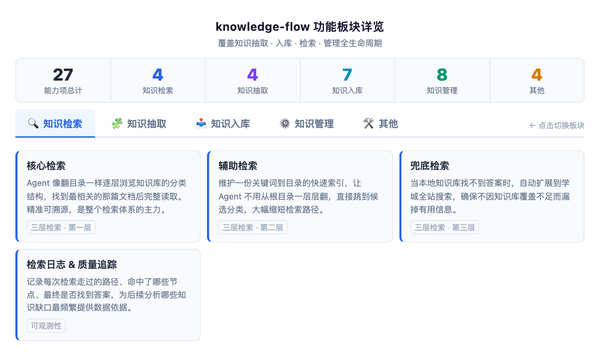

[原始 HTML（下载后可交互）](../../../assets/citadel/2783426698/diagram-01.html)

<details>
<summary>展开其他交互状态的预览</summary>

**🧩 知识抽取**

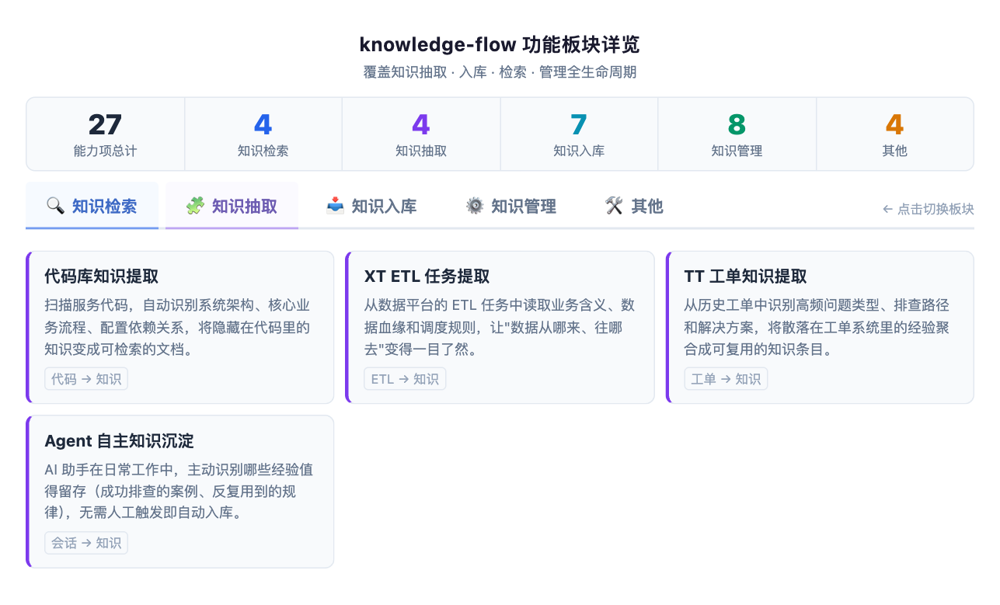

**📥 知识入库**

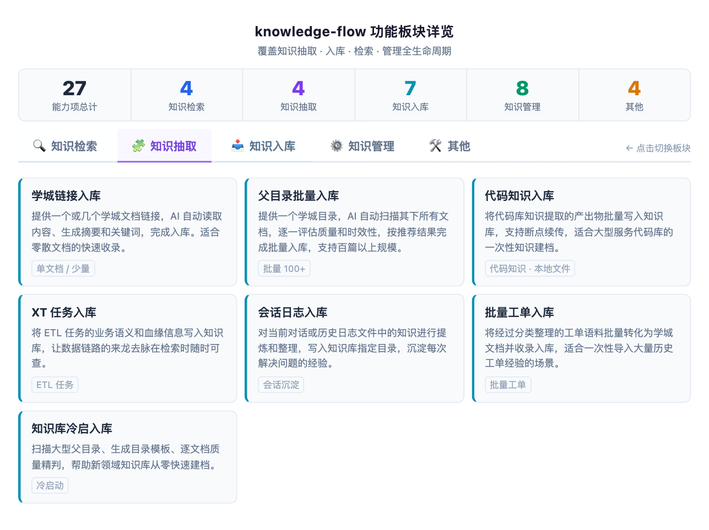

**⚙️ 知识管理**

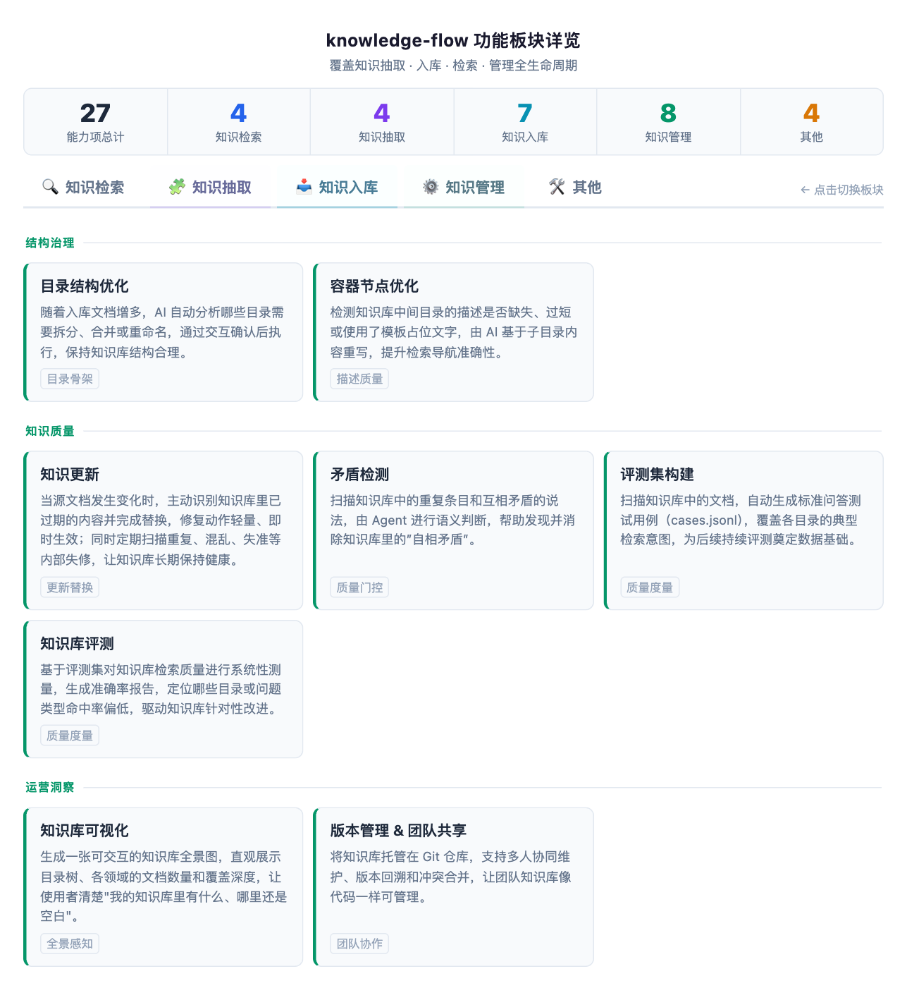

**🛠 其他**

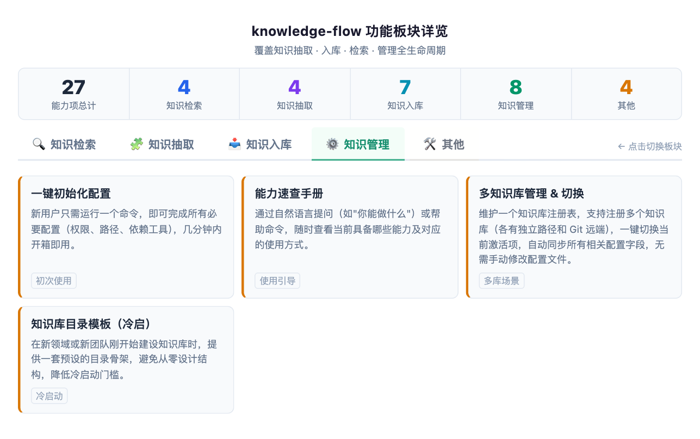

</details>


### 3. 知识库的组织形式

整个知识库是一棵目录树。每个目录下都有一个 `data_structure.md` 文件，但它在不同位置扮演的角色不同：

- **中间层目录（容器节点）**的 `data_structure``.md` 是一份“导览牌”，每个子目录对应一段描述，告诉 Agent 这个方向收录的是什么类型的内容。Agent 读到这里，只需判断“我的问题是不是这个方向的”，然后决定是否继续深入。这一层不存放任何文档链接，职责只有一个 —— 帮 Agent 做路由。

- **最底层目录（叶子节点）**的 `data_structure.md`才是真正的文档索引。每篇收录的文档对应一个条目，包含标题、简介、内容纲要、关键词和原始链接。Agent 走到这一层，说明已经确认这里有相关内容，接下来会读取具体文档做深度理解。

根目录下还有一份 `keyword_index.json`。它**由脚本扫描整颗目录树的关键词字段自动生成**（无需消耗Token），作用是在 Agent 开始逐层导航之前，先给出一个“候选入口目录”的提示，省去从根目录一层层遍历的时间。索引只负责加速，不能替代导航——命中索引后，Agent 仍然会走完完整的导航流程再读取文档，确保内容是经过验证的，而不只是关键词匹配。

（点击知识库文件结构查看详情）

<!-- HTML 内容 -->
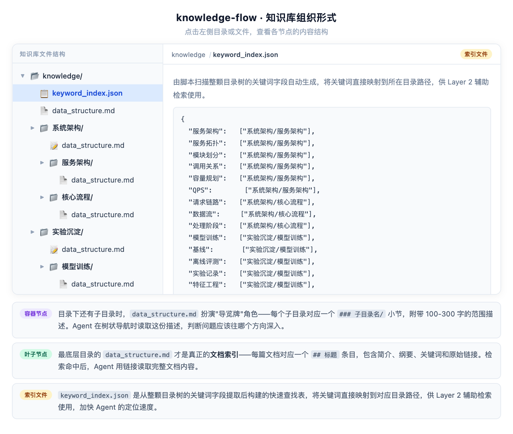

[原始 HTML（下载后可交互）](../../../assets/citadel/2783426698/diagram-02.html)

<details>
<summary>展开其他交互状态的预览</summary>

**📋
keyword_index.json (root-idx)**


**📄
data_structure.md (root-md)**


**📝
data_structure.md (dir-sys-md)**


**📄
data_structure.md (dir-svc-md)**


**📄
data_structure.md (dir-flow-md)**


**📝
data_structure.md (dir-exp-md)**


**📄
data_structure.md (dir-train-md)**


</details>


### 4. 知识检索

#### 4.1 三层检索架构

**第一层：核心检索（Core Retrieval）**

第一层是 knowledge-flow 检索体系的主力。它通过树状导航的方式，逐层读取 `data_structure.md`，定位到相关的文档链接或本地路径，然后通过学城工具调用（citadel）或本地文件读取（Read）按需加载内容。这种方式精准、可溯源，适合处理领域专业知识。想象一下在图书馆里查资料，你先找到相关的书架（根目录），再找到具体的分类（子目录），最后找到目标书籍（文档链接）—— 核心检索就是这样的导航过程。为避免过度展开，文档读取上限为 5 次。

**第二层：辅助检索（Assisted Retrieval）**

第二层通过`keyword_index.json` 提供关键词索引，帮助第一层快速定位候选目录。这里有个重要约束：关键词索引只用于加速定位，命中后必须回到树状导航继续验证，不能直接触发文档读取。就像图书馆的索引卡片，它能告诉你“关于这个话题的内容可能在某个分类下”，但你还是要去书架上确认，而不是直接从卡片上读内容。索引为扫描生成，每次知识库更新后自动重建（基于脚本，无需消耗Token）。

**第三层：兜底检索（Fallback Retrieval）**

当本地知识库无法提供相关内容时，系统会自动触发学城全局搜索。触发条件分三种：① 本地 0 次文档命中时强制触发；② 本地信息不足以回答时可选触发；③ 本地知识库已充分回答时禁止触发。这一层的覆盖面广，对搜索结果按关键词命中数打分排序，取前 3-5 篇精读，并在返回答案时清晰标注来源，让用户明确区分知识边界。

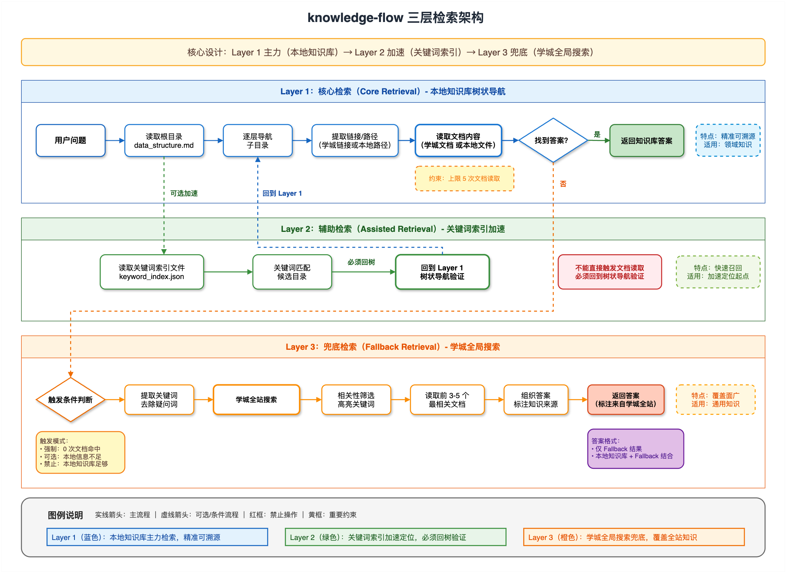

[原始 SVG](../../../assets/citadel/2783426698/drawio-source.svg) · [可编辑 Drawio 文件](../../../assets/citadel/2783426698/drawio-source.drawio)

#### 4.2 检索日志 & 质量追踪

每次检索结束后，knowledge-flow 会自动把这次检索的完整过程写入本地的 `retrieval.jsonl`——走了哪些目录、最终读取了哪些文档、有没有触发兜底搜索。这份日志不需要人工维护，也不影响正常使用，但它是了解知识库健康状况的第一手数据来源。

例如，以下几类现象，出现时通常对应明确的改进方向：

**反复触发兜底搜索**。如果某类问题的日志里 `fallback_triggered` 持续为 true，说明本地知识库对这个方向的覆盖是空白的 —— Agent 在本地没有找到任何相关内容，只好去学城全站搜索。这是知识库入库优先级最直接的信号，对应的问题方向就是下一步应该补充的文档。

**每次检索都读满了文档数量上限才停下**。说明某个目录下积累的文档太多、主题混杂，Agent 需要把所有文档翻一遍才能找到答案，甚至翻完了还没找到。这类信号对应目录结构优化里的拆分操作。

> **📂 折叠块（默认折叠）：检索日志 示例**
>
> {
> "session_id": "20260506_111625_3vv",
> "timestamp": "2026-05-06T11:16:25",
> "question": "什么是ccwhat?",
> "knowledge_base": "knowledge-self-used",
> "nav_paths": [
> "数据与指标/监控告警",
> "系统链路与数据口径"
> ],
> "recalled_docs": [],
> "km_calls_used": 0,
> "local_reads_used": 0,
> "fallback_triggered": true,
> "fallback_docs": [
> {
> "title": "CCWhat（See See What）：开箱即用的 Claude Code 可视化智能分析工具",
> "link": "[CCWhat（See See What）：开箱即用的 Agent 可视化智能分析工具](https://km.sankuai.com/collabpage/2757288182)",
> "type": "fallback",
> "source_dir": "fallback_search"
> }
> ],
> "outcome": "unknown"
> }

### 5. 知识抽取

- **代码库知识：**代码库知识的提取工作由外部 skill（knowledge-extractor）负责，它扫描服务代码、识别系统架构、业务流程和配置依赖，产出结构化的 .md 和 .txt 文件。knowledge-flow 接收这批产出物后完成本地入库，支持断点续做。

- **XT ETL 任务：**从数据平台读取 ETL 任务的 SQL、调度配置与下游血缘关系，由 Agent 提炼出数据链路语义（上游输入表、直接下游表、调度周期、核心逻辑）后写入知识库，让“数据从哪来、往哪去”随时可查。同样采用状态机模式，Agent 逐任务分析后写入，支持断点续做。

- **Agent 知识沉淀：**对话结束后，Agent 识别有价值的内容（排查思路、决策依据、踩坑经验、规律总结），提炼为结构化条目写入知识库。支持两种触发方式：在上下文中主动触发，或提供本地历史日志文件由 Agent 读取分析。写入时根据情况选择三种模式之一：① 首次入库时新建写入；② 已有同名条目时可选择覆盖替换，③或在已有条目末尾追加补充记录，适合对同一问题的后续补录。

- **TT 工单：**从原始工单导出文件（聊天记录形式）出发，经 Agent 知识抽取解析工单结构和关键词，再对内容进行整理、分类和合并——按问题类型归组，将散落的历史工单经验聚合成更有结构的知识单元。之后批量创建学城文档（支持断点续传），最后按分类更新知识库索引。

> **ℹ️ 信息：**
>
> 知识抽取是入库的前置环节，本节列举的几类处理形式覆盖了常见场景，**实际使用时可根据自身的知识来源灵活选择更合适的提取方式。**knowledge-flow 的核心设计重心在于知识的组织结构、检索方式和运营管理，抽取环节本身保持开放。

<!-- HTML 内容 -->
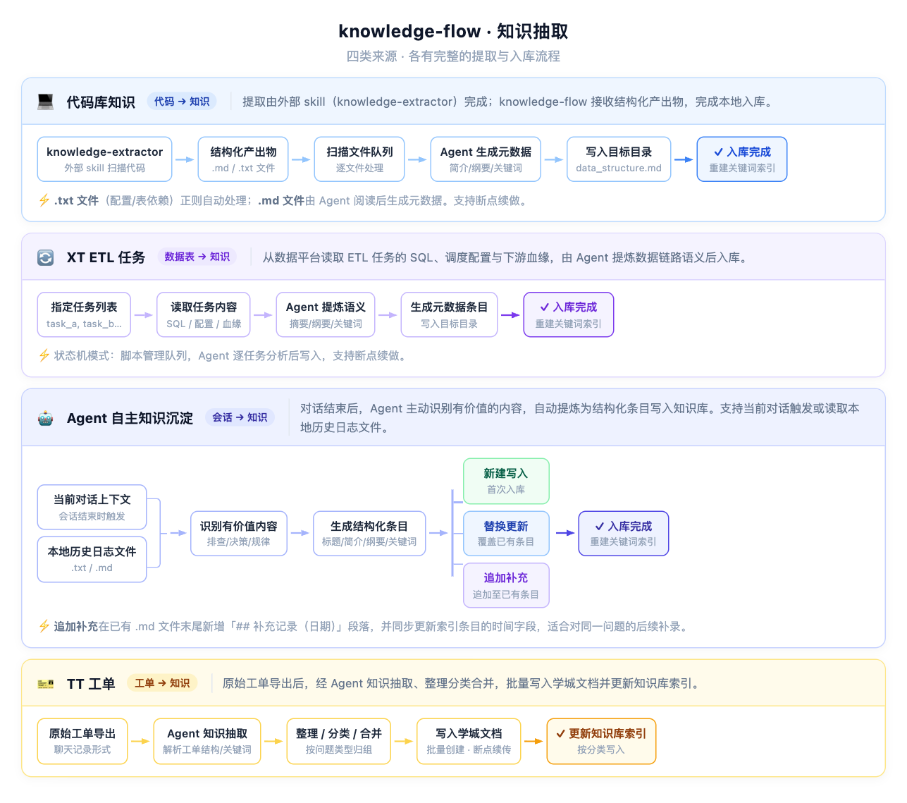

[原始 HTML（下载后可交互）](../../../assets/citadel/2783426698/diagram-03.html)


### 6. 知识入库

知识入库是将各类来源的知识写入本地知识库的过程。根据知识的存储形式，**分为两条渠道：**学城文档入库和本地文件入库。

#### 6.1 学城文档入库

学城文档入库的核心动作是：读取文档原文 → Agent 生成摘要和关键词 → 写入 data_structure.md 条目，条目中保存文档链接而非全文。检索命中时，Agent 再通过链接读取最新原文。

根据入库规模和场景，提供三种模式：

- **学城链接入库（少量文档）：**适合手里有明确目标的场景——提供几篇到十几篇文档链接，逐篇读取入库。每完成一篇才解锁下一篇（节奏闸门设计），队列持久化到磁盘，中断后可从断点继续。

- **父目录批量入库（大量文档）：**适合“知道某个目录下有大量文档、但不确定哪些值得入库”的场景。系统先扫描父目录下的全部文档，再由 Agent 逐篇评估（可跳过）——给出推荐/不推荐的判断，以及建议放入的目标目录。两个决策同时完成，过滤后的推荐项才进入实际入库流程。支持百篇以上规模，可随时中断恢复。

- **知识库冷启入库（冷启）：**适合面对全新领域从零开始建档的场景。流程分为四个阶段：首先扫描大型父目录并按文档时间和活跃度粗筛；然后由 Agent 基于文档结构生成目录模板，确定领域的知识分类骨架；再对每篇文档进行高/中/低三档质量精判，同时给出建议入库目录；最后生成结构化报告，可直接发布到学城作为领域建档进度的记录。

<!-- HTML 内容 -->
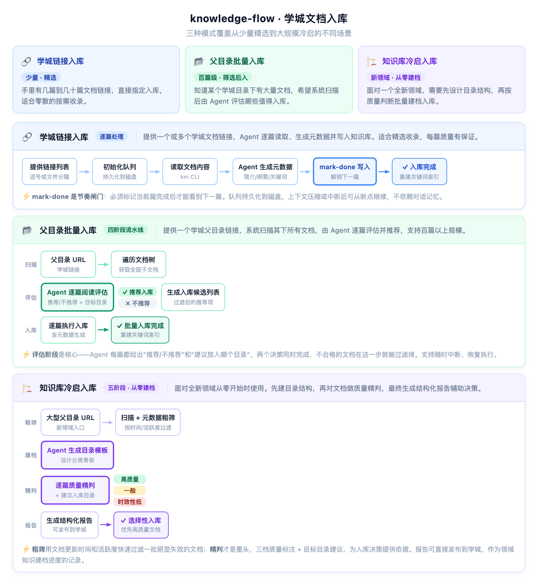

[原始 HTML（下载后可交互）](../../../assets/citadel/2783426698/diagram-04.html)


#### 6.2 本地文件入库

与学城文档入库（存摘要+链接）不同，本地文件入库将完整内容存储到知识库目录下，检索命中时直接读取本地文件，无需额外工具调用请求。

目前支持的本地文件形式包括：代码库知识提取产出的 .md 架构和流程文档、Agent 会话沉淀产出的 .md 经验文件、XT ETL 任务提取产出的 .txt 配置和数据表索引、TT 工单整理后的 .md 工单经验文件，以及其他任何可被 Agent 理解并转化为结构化条目的本地文本内容。

<!-- HTML 内容 -->
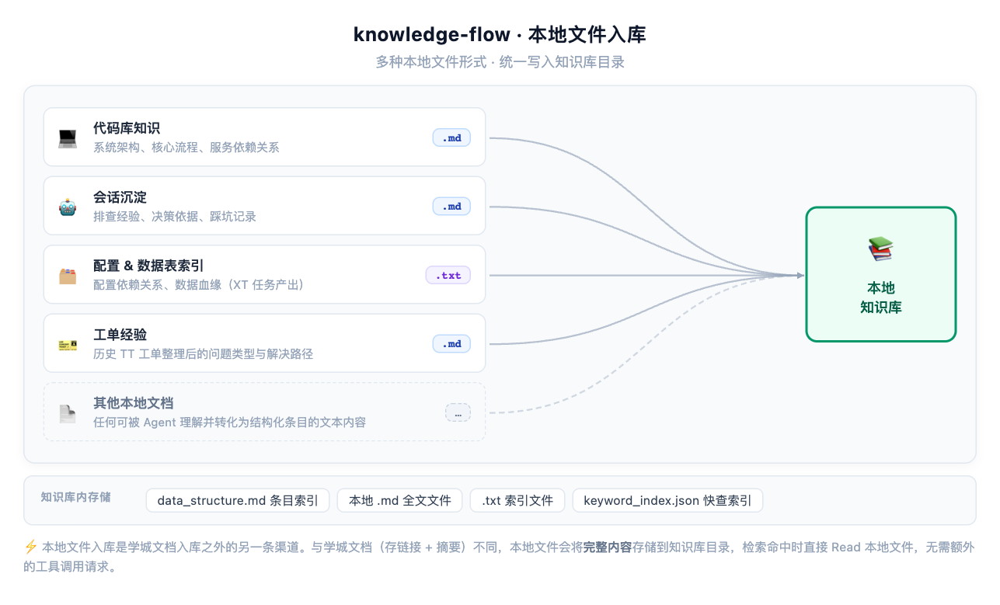

[原始 HTML（下载后可交互）](../../../assets/citadel/2783426698/diagram-05.html)


### 7. 知识管理

#### 7.1 结构治理

- **目录结构优化：**知识库的目录结构在建立初期往往是合理的，但随着文档持续写入，失衡几乎是必然的结果。某个方向的文档越积越多，原本清晰的分类开始显得混杂；另一些目录因为业务调整变得空旷；有时两个独立建立的目录在内容上出现大量重叠，检索时需要分别进入才能确认没有遗漏。这类问题如果不定期处理，知识库的可导航性会随规模增长而悄悄下滑。
> **📂 折叠块（默认折叠）：支持的操作类型**
>
> | 操作 | 适用场景 |
> | --- | --- |
> | rename_category | 目录名称与实际收录内容存在偏差 |
> | split_category | 单个目录文档过于密集，主题混杂 |
> | merge_categories | 多个目录内容高度重叠，造成冗余 |
> | move_category | 某个目录放错了层级或父目录 |
> | create_category | 某类内容缺少对应的目录容器 |
> | move_document | 单篇文档归错了目录 |
- **容器节点优化：**容器节点的描述质量是检索效果的隐性前提。Agent 在树状导航时，读取的正是各层容器节点的描述来判断“问题该往哪个方向深入” —— 如果一个中间目录的描述缺失、过短、或者停留在“待补充”之类的占位文字，Agent 在这里就失去了判断依据，只能盲目进入每个子目录逐一探索，导航效率大幅下降。
> **📂 折叠块（默认折叠）：描述质量检测规则**
>
> | 规则 | 判定标准 |
> | --- | --- |
> | 描述缺失 | 无任何描述文字 |
> | 描述过短 | 字符数低于 100 字 |
> | 模板占位文字 | 包含"待补充"等占位词 |
> | 子目录列表不一致 | 描述中提及的目录名与实际子目录不符 |

（点击橙/黄标签查看详情）

<!-- HTML 内容 -->
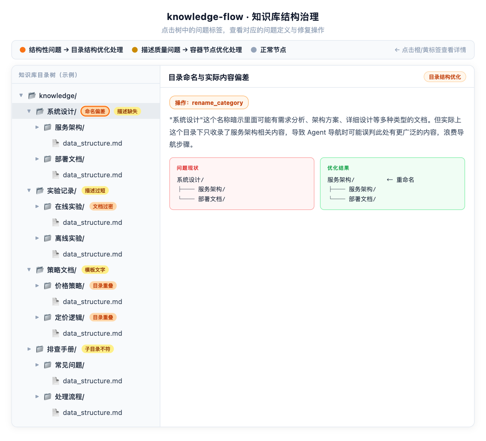

[原始 HTML（下载后可交互）](../../../assets/citadel/2783426698/diagram-06.html)

<details>
<summary>展开其他交互状态的预览</summary>

**命名偏差 (p-rename)**


**描述缺失 (p-sys-desc)**

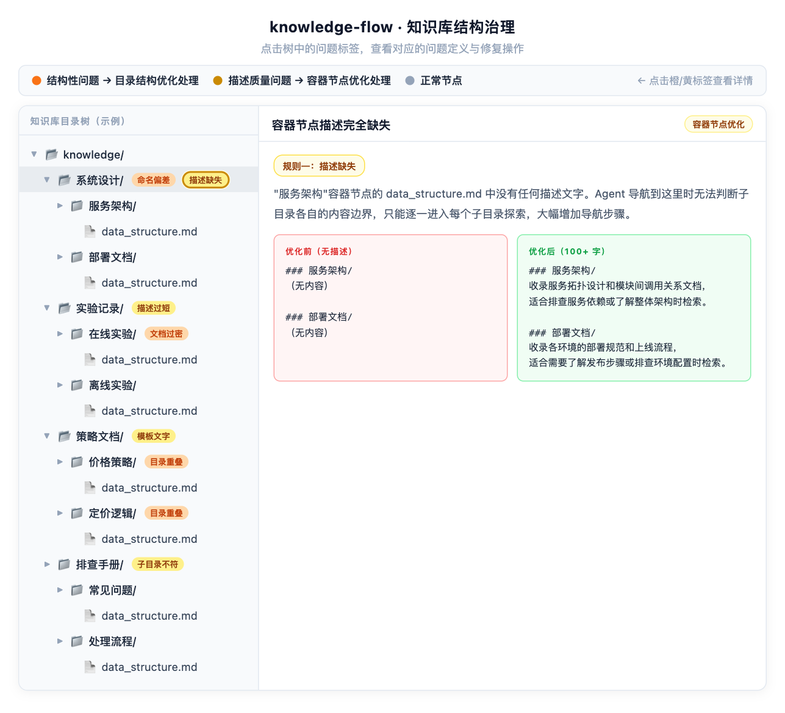

**描述过短 (p-exp-desc)**


**文档过密 (p-split)**

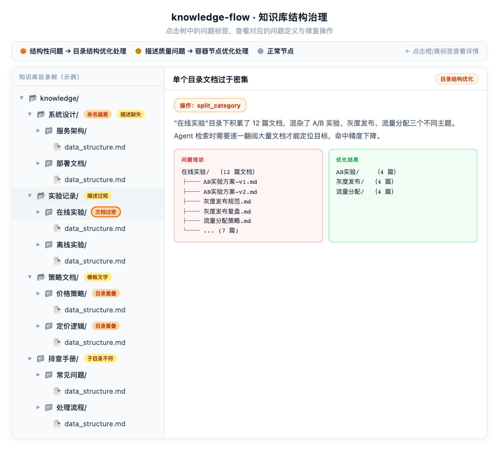

**模板文字 (p-policy-desc)**

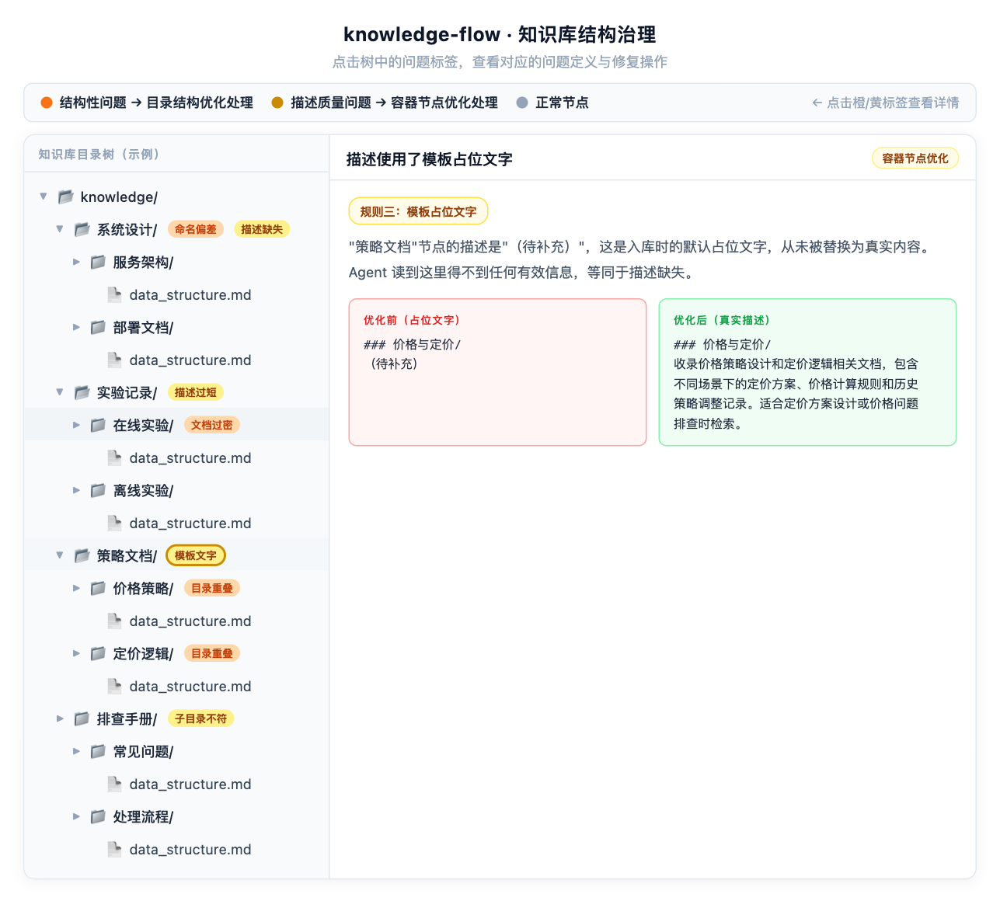

**目录重叠 (p-merge)**

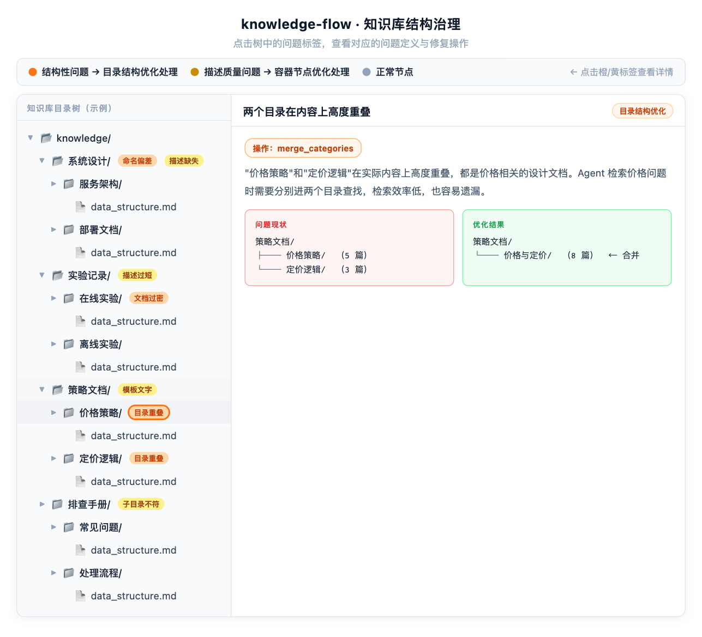

**子目录不符 (p-mismatch)**

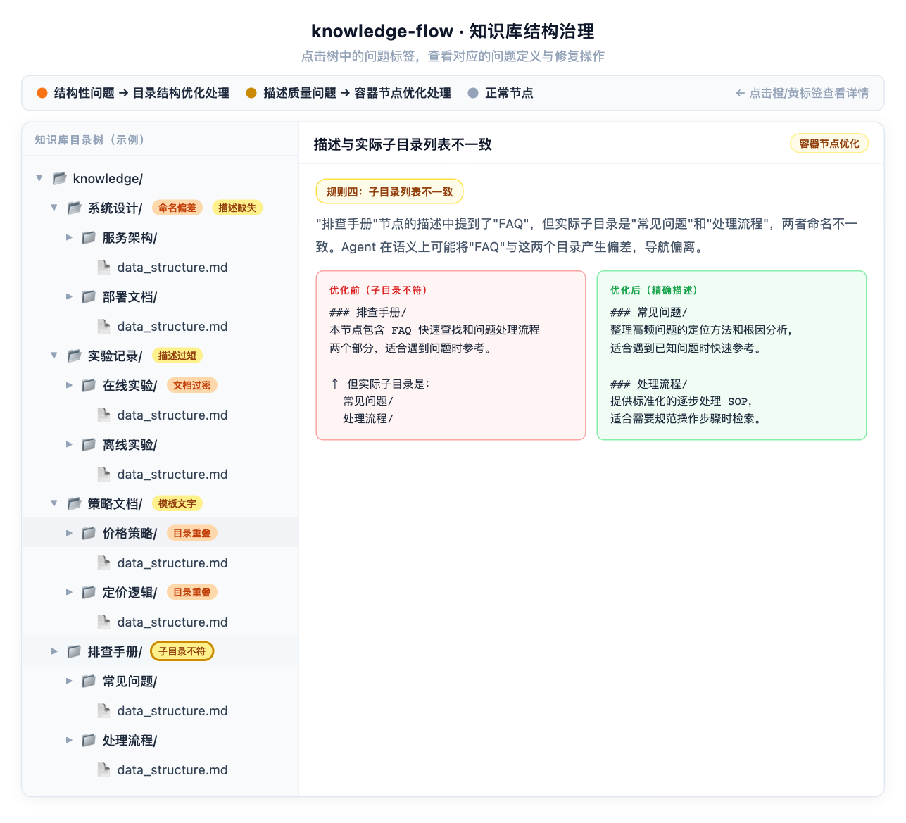

</details>


#### 7.2 知识质量

- **知识更新：**知识库中存储的是学城文档的摘要和关键词，而非原文。当学城上的原始文档被修改后，知识库里对应的摘要不会自动跟进——两者之间会逐渐产生偏差。知识更新负责弥合这个差距。
扫描逻辑以 `baseline = max(updated_at, ingest_date)` 作为每条文档条目的时效基准，将 baseline 距今超过阈值（默认 30 天）的条目列为候选，逐条读取原始文档最新内容，判断是否有实质变更：有变更则重新生成摘要、纲要和关键词并写回；文档已被删除或无法访问则标记为失效，提示人工确认是否从知识库移除。

- **矛盾检测：**随着知识持续入库，同一个概念可能在不同目录下被描述了两次，且两处的说法存在出入。矛盾检测通过批量生成候选对，再由 Agent 逐对做语义审查，识别出“同一件事有两个不一致答案”的情况。
候选对的生成来自两个维度：**同目录配对 **—— 同一叶子目录下的所有文档条目两两组合，覆盖同一业务领域内的潜在重叠；**跨目录关键词交集 **—— 来自不同目录但关键词交集 ≥ 2 的条目对，覆盖跨领域的潜在重叠。两个维度取并集后去重，交由 Agent 进行语义判断，输出疑似矛盾的条目对及置信度，由人工决定保留哪个版本或合并为一条更完整的描述。该功能适合在知识库规模较大、或经历了多人协同入库后，作为一次性的质量审查使用。

<!-- HTML 内容 -->
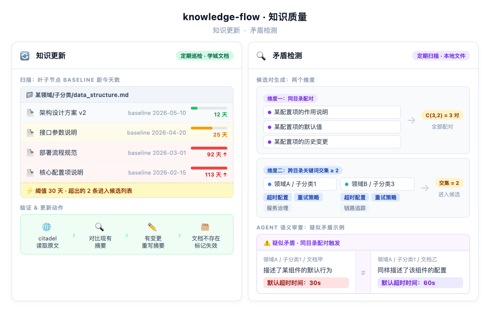

[原始 HTML（下载后可交互）](../../../assets/citadel/2783426698/diagram-07.html)


- **评测集构建 & 评测：**评测集构建和知识库评测目标是构成一条知识质量度量的流水线，解决“知识库检索效果如何、哪里还不够”这个问题。
评测集构建从知识库的叶子节点出发，选取部分收录文档（默认为50%）自动生成一道测试题：提炼一个自然语言提问（query），并标注期望命中的目录和文档作为正确答案。这份测试集可以随知识库内容的更新反复运行，充当持续检验检索质量的“标准卷”。我们也可以将真实场景下知识库接收的问题加入评测集中，并持续补充和完善。
知识库评测针对每道题计算两项独立指标：① Dir Hit 衡量关键词索引能否将 query 路由到正确目录；② Doc Hit 衡量 Agent 完成树状导航后能否最终命中目标文档。

<!-- HTML 内容 -->
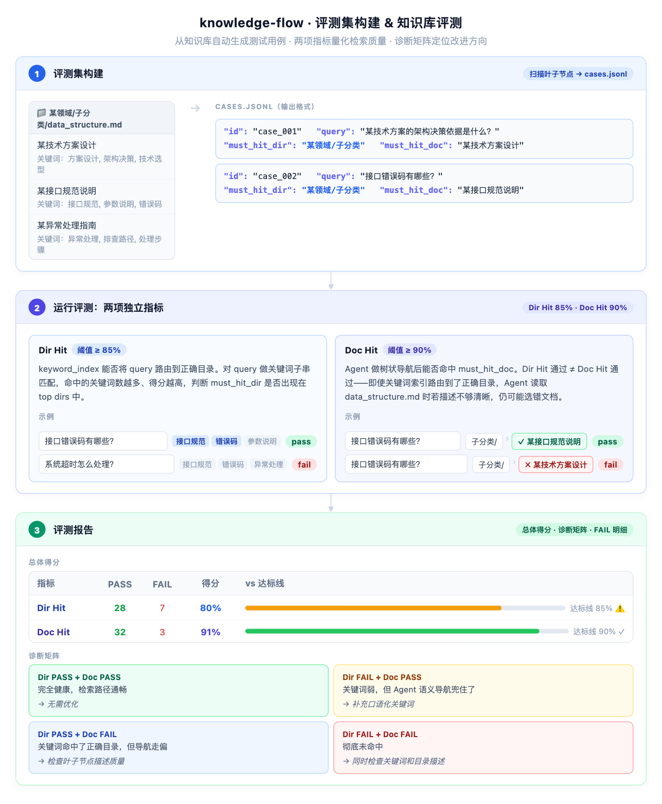

[原始 HTML（下载后可交互）](../../../assets/citadel/2783426698/diagram-08.html)


```
// FAIL 明细示例
以下是评测报告中一条 Dir FAIL + Doc FAIL 的明细输出：

### case_007   Dir FAIL + Doc FAIL

用户 Query    ：系统超时阈值怎么配置？
目标目录      ：某领域/子分类
目标文档      ：某接口配置说明
Dir Status    ：fail
Dir Routed    ：某领域/其他分类（keyword_index 无任何关键词命中目标目录）
Doc Status    ：fail
Doc Routed    ：未记录

命中关键词    ：无
未命中关键词  ：超时阈值、超时配置、timeout（建议补充到目标目录关键词）
```

#### 7.3 运营洞察

- **知识库可视化：**知识库可视化生成一张可交互的全景图，以目录树形式展示知识库的完整结构，同时标注每个分类目录的文档数量和覆盖深度，让使用者对知识库整体状况一目了然。
覆盖深度用四个级别表示：充分覆盖（≥6 篇）、一般覆盖（2-5 篇）、覆盖薄弱（1 篇）、尚无文档。“尚无文档”的目录会被显式标注，这通常是知识库下一步入库工作的优先方向。

<!-- HTML 内容 -->
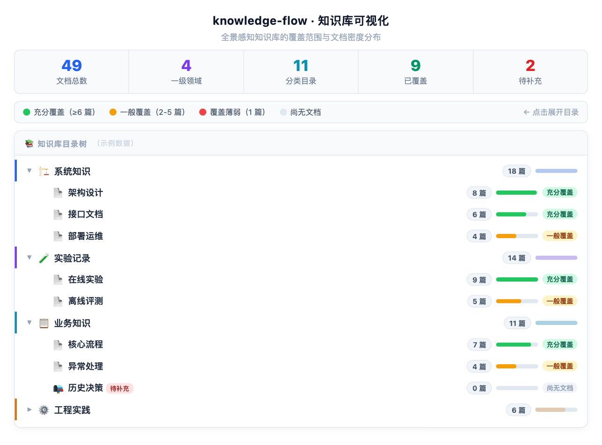

[原始 HTML（下载后可交互）](../../../assets/citadel/2783426698/diagram-09.html)


- **版本管理 & 团队共享：**knowledge-flow 的知识库是本地文件系统目录，这意味着它天然可以被 Git 管理。版本管理功能将知识库托管到一个共享的 Git 仓库，让团队成员可以各自在本地维护、通过推拉同步变更，知识库像代码一样拥有完整的版本历史和协作能力。

<!-- HTML 内容 -->
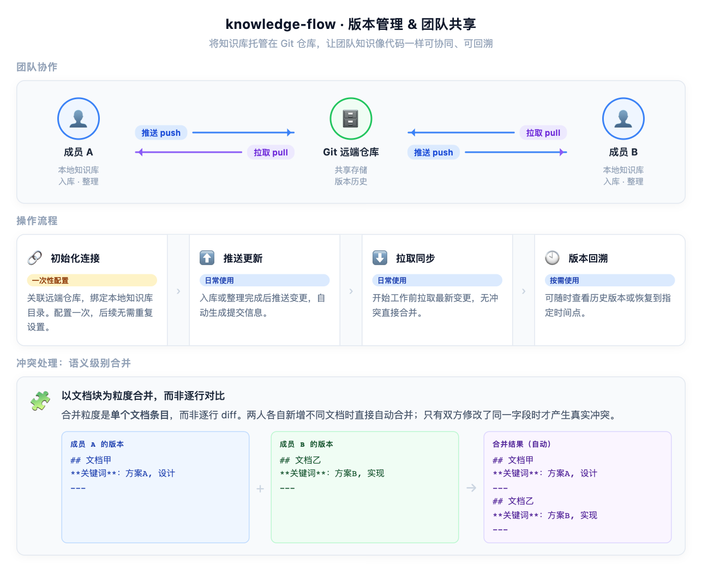

[原始 HTML（下载后可交互）](../../../assets/citadel/2783426698/diagram-10.html)


### 8. 其他

knowledge-flow **的所有功能均可通过自然语言触发，无需记住任何指令名称。**直接向 Agent 描述你想做的事，它会自动识别并执行对应的功能。

- **一键初始化配置：**首次使用时，告诉 Agent「帮我完成初始化配置」，它会自动完成三项配置：验证相关技能的安装状态（citadel等常用官方技能）、配置知识（git）仓地址、检查用户身份（MIS）配置是否正确。配置结果写入本地配置文件，后续使用无需重复设置。

- **多知识库管理 & 切换：**如果需要同时维护多个知识库（比如一个面向自己日常使用、一个供团队共享、一个用于测试），knowledge-flow 提供知识库注册表功能。注册多个知识库后，告诉 Agent「切换到某个知识库」，当前激活项会立即切换，知识库路径、Git 远端地址、关键词索引路径等所有关联配置字段自动同步更新，无需手动修改配置文件。

- **能力速查手册：**如果不确定 knowledge-flow 当前支持哪些功能，或者不知道某个操作该怎么触发，直接问 Agent「你能做什么」或「如何入库一篇文档」，它会列出当前具备的能力清单或给出具体的操作引导。

<!-- HTML 内容 -->
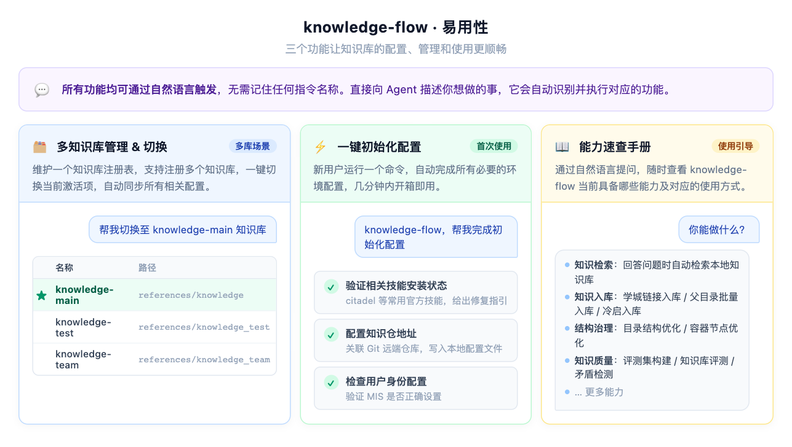

[原始 HTML（下载后可交互）](../../../assets/citadel/2783426698/diagram-11.html)


### 9. 场景实践

<!-- HTML 内容 -->


[原始 HTML（下载后可交互）](../../../assets/citadel/2783426698/diagram-12.html)


#### 9.1 需求托管开发

##### **9.1.1 工程 Agent 全托管需求迭代**

AI Coding 工具的 Demo 通常从零搭建新项目，但真实的业务开发是另一幅景象：系统历史悠久，逻辑主要通过代码流传；一次变更往往横跨代码、配置中心和数据库；还有大量隐式约定 —— 降级策略的写法、枚举值的含义 —— 既塞不进系统提示词，也没有文档记录。这类场景下，让 Agent 一次性理解整个系统并不现实，代码仓库动辄成千上万个类和方法，全量输入只会让 Agent 在信息中迷失方向。

**knowledge-flow 的角色 —— **解决这个问题的关键，是让 Agent 像一个有经验的工程师一样**按需查阅资料**，而不是在任务开始时把所有内容一次性加载。

具体的做法是构建一套三层知识体系：L1 通用层存放跨项目的编码规范和框架用法，由编排器在需要时注入；L2 项目层存放单个项目的架构设计、领域模型、历史需求实现模式和隐式约定，由 knowledge-flow 在每个执行阶段按需检索；L3 任务层是当前需求的 PRD 和阶段产物，随任务启动加载。

三层中，knowledge-flow 承担的 L2 是最难维护也最关键的部分。通用规范有文档，当前任务有 PRD，唯独项目级的历史积累过去只存在于老工程师的记忆里。用代码知识提取工具将代码库结构化入库、用学城入库功能收录设计文档、用会话沉淀功能持续积累每次需求交付的经验，形成一个可查询的项目知识库。

<!-- HTML 内容 -->
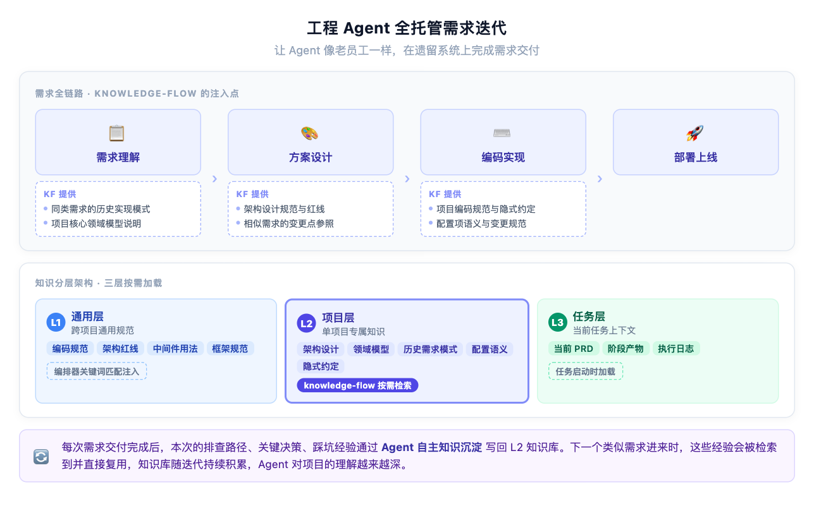

[原始 HTML（下载后可交互）](../../../assets/citadel/2783426698/diagram-13.html)


**效果**

该套方案已投入相关领域使用，持续支持需求托管开发，已完成需求开发数量3个。

##### 9.1.2 算法 Agent 需求托管开发

算法需求的开发往往不是从零开始的——团队里已经做过很多类似的预测、分析链路，积累了大量经过验证的设计模式：分层架构怎么搭、特征工程怎么拆、预测策略的优先级怎么设计、数据处理逻辑的边界规则怎么定。这些知识有的在学城文档里，有的隐藏在历史项目的代码里，有的只有做过的人才知道。每次接到新需求，工程师都要花时间去找、去问、去翻，在"弄清楚已有的是什么"上消耗大量精力，才能进入实际的设计阶段。

**knowledge-flow 的角色 —— **将历史算法链路的设计文档、方案沉淀、字段口径说明系统地入库后，Agent 在处理新需求时可以先提取该需求的关键特征（数据来源、预测目标、处理逻辑、边界场景），向知识库检索相似的历史实现。知识库能够识别出高度相似的场景，明确哪些模块可以直接复用、哪些需要适配调整，并给出每个模块的借鉴来源和调整说明。

这个过程的核心价值在于压缩了"探索期"——也就是那段靠翻代码、问同事来理解历史脉络的阶段。有了知识库的检索结果，算法设计可以直接从“已有什么、能借鉴什么”出发，而不是每次都重新梳理一遍。

<!-- HTML 内容 -->
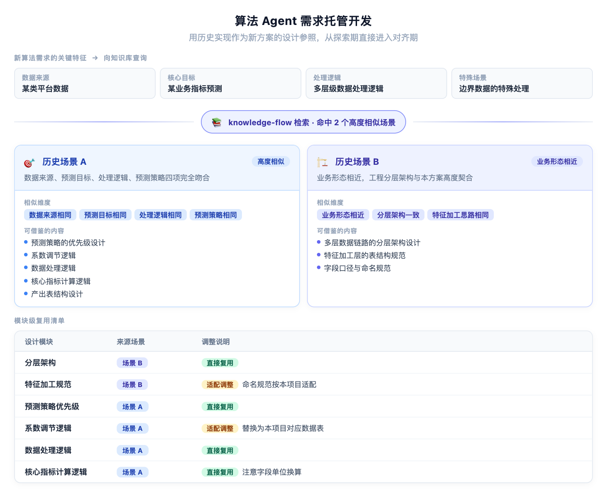

[原始 HTML（下载后可交互）](../../../assets/citadel/2783426698/diagram-14.html)


**效果**

在实际运行的案例中，新算法链路的多个核心模块（分层架构、预测策略、后处理逻辑、指标计算）均来自历史实现的复用，部分模块直接采用，部分做了少量适配调整。需求全托管开发后，交付周期压缩50%+（从12-15PD降至5-6PD），快速完成从0到1的能力搭建。节省的时间，主要来自于不再需要人工 trace 历史架构和代码细节——这两件事过去完全依赖工程师的经验和记忆，现在由知识库承担。

#### 9.2 SKILL 闭环迭代

传统 AI 技能是静态的——知识停留在编写时刻，执行中遇到的卡点只能靠人工解决，经验随任务结束消失。技能自进化机制打破了这一点：执行中产生的新经验被持续沉淀回技能自身，由两层体系支撑：

- **结构化执行日志（DEV_LOG.md）**：实时记录每步的关键决策和遇到的问题。

- **步骤切换检查点**：每个 Stage/Step 完成、进入下一步前，检测触发信号——脚本失败后找到解法、用户纠正方法、步骤遗漏、5+ 工具调用完成非显而易见任务，以及每轮末强制触发一次。命中信号后，经验分类回写各归其位。
至于"归到哪、按什么标准"，正是 knowledge-flow 分层知识结构要解决的问题。

**knowledge-flow 的角色** —— 经验分层承载与检索中枢。知识按容忍度分三层：① SKILL.md（流程主控）：主干 SOP，每次激活首先读取；② references/（步骤必读）：不能容忍遗漏的步骤强制约束（如"链路开发必须先测试再提交"），保留为必读并限制篇幅；③ 外挂知识库（领域背景）：由 knowledge-flow 按需检索，承载可接受遗漏的体量较大的领域背景知识。

三层遵循一条核心判据：**能否容忍检索遗漏 **—— 不能容忍的留在 references 必读，能容忍的下沉到外挂知识库。同时有一条硬约束：任何关键步骤开始前，必须先通过 knowledge-flow 检索知识库，不可跳过。

两条通路的评估方式不同：[SKILL.md](http://SKILL.md) / references 的知识由人工确认，保证必读层准确；外挂知识库走自动化质量管线（候选池 + 多轮汇总 + 评测集评估），支持规模化持续积累。

<!-- HTML 内容 -->
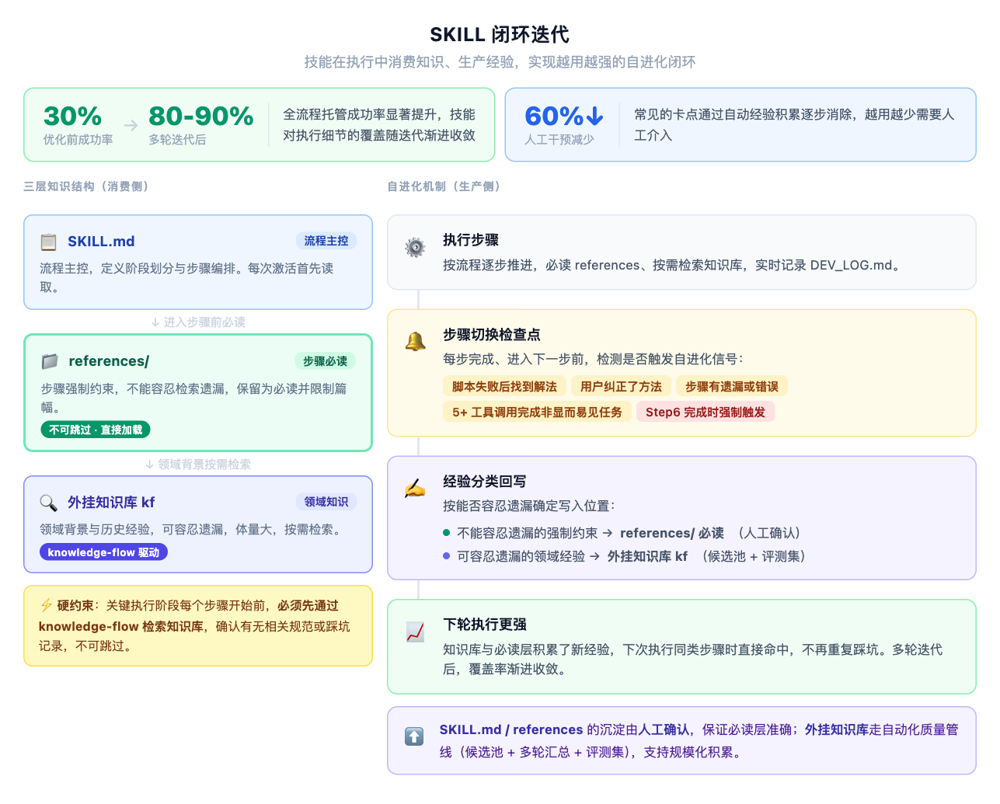

[原始 HTML（下载后可交互）](../../../assets/citadel/2783426698/diagram-15.html)


**效果**

全流程托管成功率从约 30% 提升至 80-90%，人工干预减少约 60%。改善是渐进收敛的 —— 随经验库积累，常见卡点逐步被知识覆盖，技能对执行细节的掌握持续完善。这一阶段的收益主要来自流程执行层面。进入第二阶段的算法指标闭环迭代后，同样的知识沉淀机制将延续，每轮实验的分析结论和调参依据同样写回知识库，为后续迭代提供参照。

#### 9.3 群答疑助手

业务团队日常会收到业务问题 —— 某个 case 按规则该怎么判断、某条数据是否符合标准、某类情况应该走哪个处理路径。这些问题需要熟悉业务规则的人来解答，但规则文档散落在学城各处，答疑全靠人工既耗时又不稳定，不同人的解答也未必一致。

**knowledge-flow 的角色 —— **首先用知识库冷启工具对存量业务规则文档进行质量精判和分类建档，形成结构化的初始知识库，并通过 Git 仓库管理，支持多人协同维护。之后将知识库挂载到 CatClaw 群聊虾机器人，加入业务群后，成员 @ 机器人提问即可获得响应。知识库接入后，Agent 每次回答前先检索知识库，加载相关规则后再作答，回答中会明确引用规则依据，结论清晰，边界情况有规则支撑。群里出现"📚 知识库：已加载"的标识，意味着这条回答是有规则根据的。

**知识持续积累**

使用过程中，如若 Agent 给出了错误判断，团队成员可以在群中指出正确答案并解释原因，同时指示 Agent 将本次经验写入知识库。Agent 完成写入后，随后继续使用 —— 整个纠错和入库的过程在群聊对话里完成，没有额外操作成本。随着使用积累，知识库的覆盖越来越完整，曾经需要反复解释的边界情况逐步沉淀为知识条目，后续遇到同类问题时直接命中，不再需要人工解答。

<!-- HTML 内容 -->
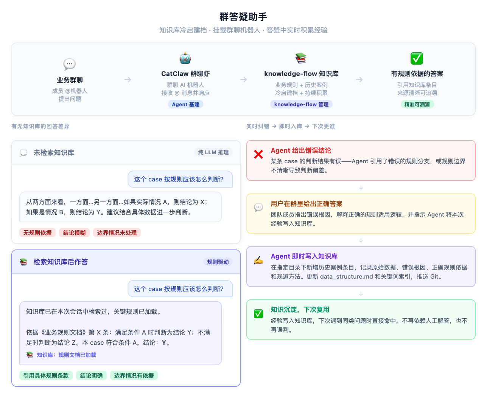

[原始 HTML（下载后可交互）](../../../assets/citadel/2783426698/diagram-16.html)


**效果**

已投入使用，持续解答业务相关问题，效果符合预期，产品持续推广中。

#### 9.4 CASE自主排查

传统排查型 Skill 的常见设计是“大 Skill + 硬编码 SOP”：把所有排查类型的步骤和 SQL 模板写在 Skill 文件里，靠意图路由跳转到对应分支执行。这种模式的问题随规模暴露 —— 新增排查类型必须修改 Skill 文件，维护成本线性上升；排查路径固定，无法根据实际数据动态调整，即便中途已经找到根因，也得机械地把剩余步骤走完。

**knowledge-flow 的角色 —— **新的设计把排查知识从 Skill 文件里彻底抽出来，沉淀到独立的知识库，让 Agent 通过检索知识、形成假设、收集证据来动态完成排查。Skill 本身只定义执行框架，不含任何业务知识。

知识库分四层：① **线索层**是核心，每个文件对应一个假设方向，内部包含触发信号、支持证据、否定证据和验证动作——Agent 拿到的是完整的"何时触发假设 → 如何验证 → 如何排除"推理框架，而不是执行清单；② **案例层**记录真实排查过程的完整 by-case 文档，保留无法泛化的边界细节；③ **SQL 参考库**存放带参数占位符和陷阱注释的查询模板，被线索层验证动作按需引用；④ **原子层**描述客观事实，包含表结构参考、指标计算口径和字段速查（含常见查询陷阱）。四层知识库均通过 knowledge-flow 管理和检索。

执行框架如图中所示，分为 6 个阶段。排查结束后触发知识沉淀，形成知识闭环。随着实际使用，线索层的触发条件越来越准确，案例层的覆盖越来越完整，整个排查体系在使用中持续精化。

<!-- HTML 内容 -->
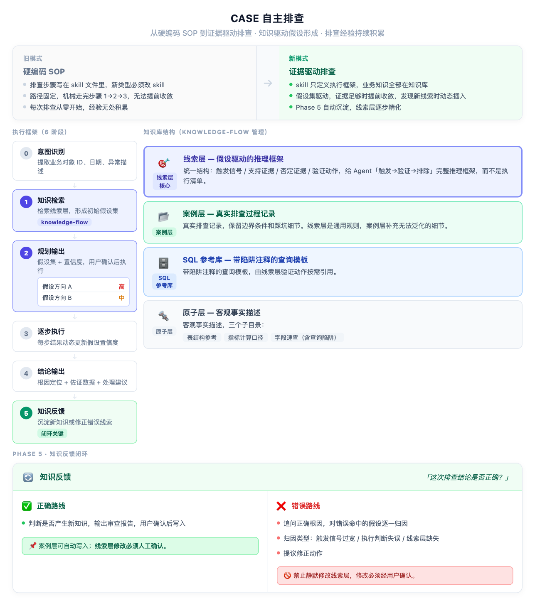

[原始 HTML（下载后可交互）](../../../assets/citadel/2783426698/diagram-17.html)


**效果**

持续支持相关场景的CASE自主排查，一次排查准确率~70%，效果优于相较于使用 SOP 式的 SKILL 排查方式。

> 📌 **附录区域**

### 附录

#### knowledge-flow 和传统 RAG 的对比

> **ℹ️ 信息：**
>
> knowledge-flow 采用文件系统目录索引设计，以分级目录树对知识进行结构化组织。Agent 按需下钻、渐进式召回。相比传统 RAG，定位更精准、上下文更完整，做到知识沉得下、易更新、用得好。

| **维度** | **传统 RAG（如Friday 知识库）** | **knowledge-flow** |
| --- | --- | --- |
| 检索方式 | 单次切片召回，天花板明显 | 多轮检索 + 跨文档推理 + 上下文语义理解，避免"召回即天花板" |
| 知识组织 | 扁平向量库 | 目录树分层索引，支持分域隔离、精准定位与透明知识结构 |
| 运营机制 | 无闭环 | 入库结构化审查 → 上线矛盾检测 → 更新巡检 → 下线历史存档，保障体量、新鲜度与一致性 |
| 进化能力 | 依赖人工规则优化 | 随 Agent 理解力、上下文长度与推理能力自然提升 |

#### Agent 知识使用的痛点与 knowledge-flow 的解法

| 痛点 | 解法思路 | knowledge-flow 关键能力 |
| --- | --- | --- |
| 知识难沉淀 | 多通道沉淀，覆盖三类知识形态 | **a. 显性知识统一接入**：学城文档、TT工单知识、代码仓知识、数据任务表等多种来源统一收敛进知识库。 **b. 过程知识当场沉淀**：依托 Agent 上下文，在交互过程中即刻提炼、即刻入库，避免上下文一散就难以追溯。 **c. 隐性知识协同显性化**：专家与 Agent 协作的过程本身就是隐性知识显性化，借过程知识路径同步落库。 |
| 知识难更新 | 低成本、系统化的更新闭环 | **a. 更新动作轻量化**：发现即修复，修复即生效。 **b. 过期知识主动识别**：知识库主动追踪源头变化，发现已过期的内容并驱动更新。 **c. 知识库持续自我治理**：定期发现并修复重复、混乱、失准等内部失修，让知识库长期保持健康。 |
| 知识难用好 | 主动导航、多类型知识统一组织 & 按需取用 | **a. 从被动召回到主动导航：**Agent 像人翻目录一样，逐层判断、逐步下钻，每一步决策都基于当层的目录描述，而非黑盒打分。整个检索过程可观测、可调优——走了哪条路径、为什么选这一支、在哪一步停下，全程可追溯。 **b. 多类型知识统一组织、按需取用：**学城文档、代码语义、数据任务血缘、历史排查经验等不同类型的知识，全部纳入同一套目录体系；Agent 在执行任务时，可根据当前需要在不同分支间穿插检索，把分散在多处的知识一次性拿齐。 |
