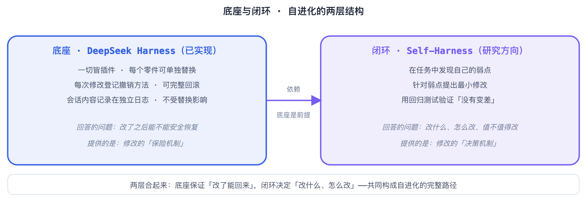
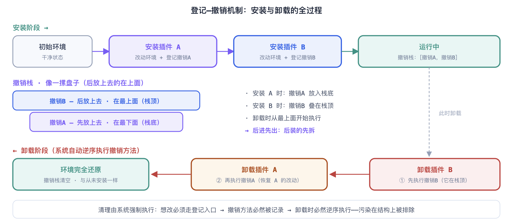
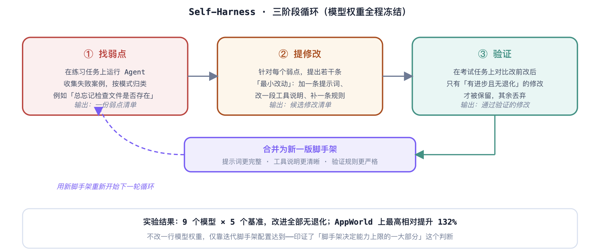

# 从 DeepSeek Harness 看 Agent 自进化

> 来源：[学城原文](https://km.sankuai.com/collabpage/2784910653) · 归档日期：2026-09-23 · 原文版本：`stepVersion=1`
>
> 本文为原文归档，未改写或独立核实其中的技术判断与数据。阅读版仅移除导出工具提示、添加本说明，并将三张图片改为仓库内引用。
>
> [原始 Markdown 导出](source.md) · [原始 CitadelXML](source.xml) · [归档元信息](metadata.json) · [文档目录](../../README.md)

让 Agent 自己改进自己，最大的障碍往往不是“不知道怎么改”，而是“改了之后出问题怎么办”。

DeepSeek Harness（下文简称 dsh）用一套“插件化 + 可回滚”的架构，把修改自己的运行环境变成一件可控、可撤销、可验证的事。

下面先从自进化本身的困引入，再分析 dsh 如何通过插件化与热插拔做到“不污染上下文、不打断运行”。最后结合 Self-Harness 与 ACE 两篇论文，说明底座之上完整的自进化路线。

### 1. Agent 自进化难点

所谓 Agent 自进化，指的是 Agent 改进自己的行为——调整提示词、增删工具、修改流程，乃至修改模型本身。这个方向听起来自然，但无论走哪条路，都会撞上具体的困难。可以从数据、离线、在线三个层面来看。

#### 1.1 数据层面：判断“改动有没有用”，本身就需要好数据

自进化的每一步都要回答同一个问题：这次改动到底带来了什么影响？变好了、变坏了，还是只是波动？

要可靠地回答它，既需要量级足够大的任务集，也需要质量足够高的任务分布。在几十个任务上的“提升”很可能只是噪声；如果任务不能代表真实使用场景，优化的方向本身也可能是错的。

其中关键的一环是 query（任务请求）的筛选：哪些任务用来发现问题，哪些用来验证改进，哪些应该排除，例如太简单、太难，或者答案已经泄漏给模型的任务。

筛选不当，自进化就会退化成“针对练习题刷分”：指标在涨，真实能力没变。这一层数据门槛，离线自进化和在线自进化都绕不开。

#### 1.2 离线自进化：

离线场景，即部署之前批量优化，主要有两条路径，都有各自的难点。

##### 路线一：训练——微调模型

用 Agent 的执行轨迹去训练模型，首先是成本高，需要大规模算力与数据；其次是流程长，从收集轨迹、标注、训练到评估，一轮下来周期往往以周计。更棘手的是 Reward 很难真正生效：Agent 任务的奖励信号稀疏、延迟，还容易被“钻空子”——模型学会迎合评分标准，而不是真正把任务做好。整体路径目前也还不够清晰。

##### 路线二：分析——不训练，归纳经验

从执行轨迹中归纳出改进，例如改提示词、改工具说明、改流程规则。它的成本低、见效快，但归纳出的修改很难达到最优解：经验有限、归纳有偏差；更难保证每次改动都是正向优化——改动之间可能此消彼长。

##### 一个值得观察的中间方向

把 Agent 的脚手架配置参数化——将提示词、工具说明、流程参数统一编码成可优化的向量——再在向量空间中用训练或搜索的方法优化，最后解码回具体配置。

这相当于“训练的是配置，而不是权重”：有望把训练方法的系统性与分析方法的低成本结合起来。这个思路目前还是一个开放问题，值得持续关注。

#### 1.3 在线自进化：最终目标，核心是可控性

在线场景：Agent 一边服务用户、一边持续改进自己，是自进化的最终形态。它在前两层困难之外，又多出一类全新的难题：怎么保证自我修改是可控的？具体是三件事。

1. **改坏了怎么恢复？**
Agent 给自己打了“补丁”，结果新补丁有缺陷。如果系统没有记录改动之前的状态，就没有退路。
2. **改动会不会影响别人？**
组件相互依赖：Agent 正在处理一个长任务，此时替换组件，会不会弄丢已经积累的对话和中间结果？
3. **改动会不会干扰正在运行的任务？**
Agent 正在处理一个长任务，此时替换组件，会不会弄丢已经积累的对话和中间结果？

这正是 DeepSeek Harness 正在探索的问题——用插件化、可回滚、日志隔离来回应这三个可控性难题。需要说明的是，这套方案目前也并不完美，仍在快速演进之中；它给出的是一个有工程说服力的方向，而不是终点。

简单说，自进化的困难分成三层：

**数据层：**判断改动效果需要量大质优的任务与筛选机制（对应第 5、6 节两篇论文的任务集设计），

**离线层：**要在高成本训练与不够稳定的经验归纳之间取舍，在线层则要确保修改过程可控。后文会沿着这条线展开：dsh 回应在线可控性，Self-Harness 讨论“怎么改”，ACE 则讨论“改的素材从哪里来”。

**在线层**：可控性，对应第 3、4 节的 DeepSeek Harness 底座

### 2. DeepSeek 对自进化的理解

DeepSeek先后开源了 DeepSeek-V2、V3 等大语言模型。2025 年 1 月发布的推理模型 R1，以明显更低的训练成本达到了当时第一梯队的推理能力，并采用 MIT 协议完全开源，在全球范围内引发了广泛关注——开发者可以自由地研究、部署和二次开发它的模型，公开的技术报告也把训练方法讲得很透。

DeepSeek Harness（dsh）同样是开源项目，其背后的编程范式研究整理为 Cordis 论文[A Programming Paradigm for Spatiotemporal Composability](https://arxiv.org/abs/2608.25512)（北京大学 + DeepSeek-AI）

基于 Cordis 论文的工作，DeepSeek 对自进化有一个很清晰的基本判断。

#### 2.1 自进化不一定要改模型权重

一个 Agent 的表现，并不完全由模型权重决定。系统提示词怎么写、有哪些工具可用、工具说明是否清楚、执行流程怎么安排、结果怎么验证——这些“模型之外”的配置，同样深刻影响着 Agent 的能力。这一层通常被称为 **harness（脚手架 / 运行环境）**。

修改脚手架比修改模型权重有三个现实优势：不需要重新训练，成本低；改了什么一目了然，可解释；配置文件还能退回上一个版本，可撤销。

所以 DeepSeek 选择的路线是：把自进化的问题，转化为“如何安全地修改脚手架”的问题。

Cordis 论文在动机部分（§1.2.2）明确讨论过“自进化的 Agent 脚手架”这一场景：未来的运行环境可能需要在服务请求的同时，生成并部署对自身组件的修改。

要做到这一点，系统必须同时满足两个条件：

1. 改动可以完整撤销，即**时间维度**的可组合性。
2. 组件之间能感知并适应彼此的变化，即**空间维度**的可组合性。

这两个条件正是 Cordis 全部设计的目标。

#### 2.2 前提：脚手架本身必须“可安全修改”

问题在于，传统 Agent 框架的脚手架是一团“硬编码”：工具列表写死在代码里，提示词散落在各处，组件之间在启动时绑定。想在运行中修改它，就回到了第 1 节的三个困难。

所以 DeepSeek Harness 的定位不是“又一个 Agent 框架”，而是一个为“被修改”而设计的运行底座。它把整个 Agent 拆成可以单独替换的零件，并为每次替换提供登记、撤销和验证的机制。

这里其实有两个层次。底层是已经实现的 DeepSeek Harness：一切皆插件，每个零件都可以单独替换；每次修改都要登记撤销方法；会话内容则记录在独立日志中。它解决的是“改了之后能不能安全恢复”，相当于一套保险机制。

再上一层是 Self-Harness 所代表的研究方向：在任务中发现弱点，针对弱点提出尽量小的修改，再用回归测试确认没有变差。它解决的是“改什么、怎么改、值不值得改”，更像一套决策机制。底座保证“改了能回来”，闭环决定“改什么、怎么改”，两者合起来才是完整的自进化路径。

### 3. DeepSeek Harness 的三个精髓

dsh 的仓库有 200 多个软件包，细节繁多。但对理解自进化而言，抓住三个核心设计就够了——它们分别回应第 1.3 节中在线可控性的三个难题。

**1.一切皆插件。** 模型调用、工具执行、文件系统、界面，甚至 Agent 的主循环本身，全部是插件。没有哪个部件拥有特权地位，任何零件都可以按名字替换、关闭或新增。从结构上看，修改自己=替换插件。

**2.每次修改都登记撤销方法。** 系统里修改状态只有一个入口：`ctx.effect()`。每次调用它做修改时，必须同时登记一个“撤销函数”（相当于存档点）。插件被卸载时，系统自动执行这些撤销函数，把环境恢复原状。

这解决了“改坏了怎么恢复”。

**3.会话内容只记录、不篡改。** Agent 与用户的所有交互——消息、工具调用、返回结果——都写入一本“只追加、不修改”的日志，像流水账本，写上就不能擦。模型看到的一切内容，都能从这本日志重建出来。

这解决了“改动会不会干扰运行中的任务”。

**DeepSeek Harness = 一棵可替换的插件树 + 一个唯一的修改入口 + 一本不可篡改的会话日志。**

新行为通过挂新插件实现，旧行为通过卸载插件撤销；正在进行的会话则由日志独立承载，不依赖任何具体插件。

#### 3.1 事件机制：组件之间怎么协作

插件之间不直接调用彼此，而是通过“事件”协作。dsh 里有四种事件分发方式，其中最常用的一种在源码里叫 `waterfall`中间件接力：

1. 每个事件像一条接力跑道，跑道上按顺序站着若干个插件。
2. 参数从第一个传到最后一个，每个插件拿到参数后可以选择原样传下去、修改后传下去，或者直接打断，不再往后传。
3. 最后一个插件处理完，结果就是这条事件的最终输出。

这个设计让“干预执行流程”变成了一件很平常的事：想给所有工具调用加一层权限检查？在跑道上插入一个新插件就行，不需要改动任何现有代码。

另外三种分发方式分别是：`parallel`，多个插件同时收到事件，类似广播；`serial`，按顺序逐个等待处理；`emit`，只发送通知。思路：组件通过挂事件来参与系统，而不是写死在流程里。

### 4. 插件化与热插拔的原理

这一节回答两个具体的问题：替换插件时，为什么不会污染上下文？为什么不会影响正在运行的任务？

#### 4.1 怎么不污染上下文：登记—撤销机制

污染上下文：指一个插件安装时，会往运行环境里添加服务、注册监听器、修改配置——都是它留下的“痕迹”。如果卸载时不清理干净，残留的痕迹就会影响后续运行。

dsh 的解法是让痕迹必然可清除。规则很简单：

1. **修改：** 插件想改环境，只能调用 `ctx.effect()`。
2. **登记：** 每次修改，同时登记一个对应的撤销函数。
3. **撤销栈：** 撤销函数按顺序叠放，像一摞盘子。
4. **卸载：** 插件卸载时，系统自动执行撤销函数，逐个还原。

关键在撤销的顺序：**后进先出（LIFO，Last In First Out）**。

之所以必须这样，是因为后来的修改可能建立在早前修改的基础上。只有先撤销后面的，再撤销前面的，每一步才都能正确还原。

例如，初始撤销栈为空。安装插件 A 后，栈里记下“撤销 A”；再安装插件 B，“撤销 B”会压在上面。卸载时先执行撤销 B，再执行撤销 A，最后栈重新变空，环境也回到最初的干净状态。

这套设计之所以能避免污染，是因为清理不是靠插件“自觉”，而是由系统强制完成：想改环境，就必须走唯一的修改入口；走了这个入口，撤销方法必然被登记；插件卸载时，它们又必然被逆序执行。污染的可能性因此在结构上被排除，而不是依赖开发者处处小心。

#### 4.2 怎么不影响运行：状态与组件分离

第二个问题：替换组件时，Agent 可能正在处理一个长任务，上下文里已经积累了大量对话和工具结果。这些“正在进行的状态”放在哪里，决定了替换会不会弄丢它们。

dsh 的答案是把状态和组件彻底分开：

- **会话状态**：对话历史、工具结果全部写在日志里。日志是独立的一层，只追加、不修改，不隶属于任何插件。
- **插件**只提供“处理能力”，不持有“会话数据”。模型调用走插件 A 还是插件 B，日志本身没有任何变化。
- 需要给模型发请求时，系统从日志重新推导出该发的内容。推导过程是确定性的，同样的日志必然得到同样的请求。

由此，热替换（在程序不重启的情况下更换零件）可以按四步安全进行：

1. **暂停接收新请求：** 正在处理的任务继续跑完，新请求排队等待。
2. **卸载旧插件：** 自动执行它的撤销方法，清理它在环境中留下的痕迹。
3. **安装新插件：** 重新登记新一套撤销方法，对外接口保持不变。
4. **恢复接收：** 后续请求走新插件，对话无缝继续。

四步全程，日志不用改，对话历史、工具结果原样保留，新插件从同一本日志继续推导后续请求。

#### 4.3 可替换带来的自由度

在这套机制下，“换零件”变得很日常。一个有代表性的例子：dsh 的命令行执行有三种实现——本机直接执行、沙箱隔离执行、远程虚拟机执行。

三种实现的接口完全相同，替换时只改一个配置项。模型看到的工具名称和使用方式不变，Agent 的其他部分也不需要任何改动。

这正是自进化需要的自由度：改进 Agent 的某个方面，可以精确到“只换那一个零件”，而不必重写整个系统。改动范围小，意味着风险小、验证容易、出问题时回滚也快。这些性质加在一起，才让“Agent 自己动手改自己”从危险操作变成可控操作。

### 5. 自进化闭环：从底座到自动改进

底座解决了“改了能安全恢复”，但还有一半问题没回答：Agent 应该改什么？怎么知道改了之后真的变好了？

参考Self-Harness 论文[arXiv:2606.09498](https://arxiv.org/abs/2606.09498)（上海人工智能实验室，v2，2026-08）解释这部分

#### 5.1 实验设定：只改脚手架，不改模型

Self-Harness 做了一个很干净的实验：把模型权重完全冻结——选了 MiniMax M2.5、Qwen3.5、GLM-5 三个基座，参数都冻结——只允许修改脚手架的配置，包括系统提示词、工具说明、验证规则。

然后，让 Agent 自己完成“发现弱点 → 提出修改 → 验证效果”的完整循环。

为了公平地评估改进是否真实，实验用了两套互不重叠的任务集。一套是练习任务，用来发现问题、总结弱点，Agent 在这些任务上的失败案例是提出修改建议的依据；另一套是考试任务，只用来验证修改效果，从不展示给提建议的环节。这就像把模拟考和高考分开出题，可以防止“针对考题刷分”式的虚假进步。

#### 5.2 三阶段循环

整个闭环由三个阶段组成，而且全部由同一个被冻结的模型完成。

第一步是找弱点。Agent 先在练习任务上运行，收集失败案例，再按模式归类，比如“总忘记检查文件是否存在”，最后得到一份弱点清单。

第二步是提修改。针对每个弱点，模型提出若干条尽量小的改动：加一条提示词、改一段工具说明，或者补一条规则。这些改动先进入候选清单，并不会立刻生效。

第三步才是验证。在考试任务上对比修改前后的结果，只有“有进步且无退化”的改动才会保留，其余全部丢弃。

通过验证的修改会合并成新一版脚手架——提示词更完整、工具说明更清晰、验证规则更严格——再用新脚手架开始下一轮循环。

实验结果：9 个模型 × 5 个基准，改进全部无退化；AppWorld 上最高相对提升 132%。不改一行模型权重，仅靠迭代脚手架配置就达到这一结果，印证了“脚手架决定能力上限的一大部分”这个判断。

自动修改最大的风险是自我感觉良好：模型提出一条修改，很可能在它自己看来是合理的，但实际效果可能变差，也可能只是“恰好适应了练习任务”。

所以第三阶段的两套任务集设计很重要：考试任务从不给提案环节看，验证标准是“有进步且无退化”。把“觉得有用”换成“测过有用”，这是整个闭环里最朴素也最有效的安全措施。

#### 5.3 底座与闭环如何配合

Self-Harness 的论文实验是在自己的环境里运行的。但设想把它放到 dsh 这样的底座上，整套流程会衔接得很自然。

找弱点的阶段，Agent 的所有行为都已经记录在会话日志里，所以失败分析可以直接基于日志回放，不需要额外埋点。

提出修改的阶段，因为一切皆插件，“补一条提示词”“换一个工具实现”“加一层检查”都对应明确的插件操作，改动可以精确到单个零件。

验证通过，新插件就继续生效；验证不通过，则卸载新插件，之前登记的撤销方法自动执行，环境回到改动以前。回滚不需要额外操作，正在服务的其他会话也由日志独立承载，因此自进化循环可以在不打断用户任务的情况下持续进行。

这两个部分的分工很清楚：底座解决“怎么改才安全”，闭环解决“改什么、值不值得改”。前者已经在 dsh 中实现，后者仍是正在验证的研究方向。

### 6. 经验路线：ACE 论文

Self-Harness 回答了“怎么改”，但改动需要的素材——从哪里发现弱点、归纳经验——同样重要。ACE 展示了一条“规模化经验挖掘”的路线，正是第 1 节所说分析路线的代表性实践。

ACE 的论文题目是 [Agentic Context Engineering: Evolving Contexts for Self-Improving Language Models](https://arxiv.org/abs/2510.04618)由斯坦福大学、SambaNova 和西蒙弗雷泽大学合作完成，发表于 2025 年 10 月。它的核心主张是：除了训练权重，语言模型还有一条便宜的改进通道——让上下文自己进化。

#### 6.1 核心思想：改进通道不止权重一条

一个 Agent 的“聪明程度”由两部分共同决定：

1. **模型权重：** 靠训练改进。
2. **上下文：** 提示词、记忆、工具说明等，靠工程改进。

上下文通道的优势与第 2 节的判断一致：改动成本低、即时生效、可以撤销。ACE 在此基础上更进一步：上下文里的经验不必依赖人工编写，可以从 Agent 自己的执行轨迹中批量挖掘。

#### 6.2 工作机制：从轨迹到经验的流水线

ACE 的核心组件叫 **Context Rover**——一条由 LLM 驱动的分析流水线，分四步运转：

1. **收集轨迹：** 收集 Agent 在任务集上的完整执行记录，包括成功与失败。
2. **批量挖掘：** Context Rover 从中归纳出“可执行的经验条目”。
3. **验证：** 在独立测试任务上验证，通过才保留，思路与第 5 节相同。
4. **沉淀：** 写入记忆、工具说明或提示词，并随使用持续更新。

挖掘出的经验沉淀在三个位置：

- **结构化记忆：** 按需检索的笔记，例如“处理大型仓库时先看目录结构”。
- **工具说明：** 越用越准的“使用手册”。
- **系统提示词：** 批量进化后的规则与指导。

三者合起来，构成一个不训练也能持续变聪明的 Agent。

#### 6.3 结果与本文主线的呼应

在不做任何模型微调的前提下，ACE 把一个开源模型在 SWE-bench Verified——真实软件修复基准——上的通过率提升到 54.6%，超过当时所有同类方法；上下文的有效利用率约提升一倍，单任务成本约 0.5 美元。

这个结果建立在大量执行轨迹之上。轨迹的收集与筛选、验证任务的隔离，正是第 1 节所说的数据层问题。没有干净的任务数据，经验挖掘同样会“挖偏”。

它也证明了“不训练、靠归纳”这条路能走多远——比很多人预期的更远；但论文同时承认，归纳质量受限于模型自身的理解能力，离最优解仍有距离。

这正好印证了第 1 节的判断：分析路线性价比高，但天花板取决于基座模型。

把 Self-Harness 与 ACE 放在一起看，分析路线的两个环节都有了代表工作：Self-Harness 管决策，从发现弱点一路走到回归验证；ACE 管素材，从大量轨迹中稳定地产出可复用的经验。两者都绕开了训练权重，也都依赖第 1 节所说的数据基建。

### 7. 总结

回顾全文，DeepSeek 对 Agent 自进化给出了一条清晰的路线。

自进化不等于改模型权重。提示词、工具、流程这些“脚手架”层面的配置，同样决定 Agent 的能力，而且改起来成本低、可解释、可撤销。先把这一层做好，是务实的第一步。

要让脚手架能被安全修改，运行环境本身要先被改造。一切皆插件，让结构可以替换；修改时登记撤销方法，让改动可以回滚；会话写入独立日志，让正在运行的任务不受干扰。dsh 把这三点做成了工程现实。

在底座之上，Self-Harness 用“找弱点 → 提最小修改 → 独立任务集验证”决定改什么；ACE 从执行轨迹中批量挖掘可复用经验。

两者都表明：不动权重、只迭代脚手架与上下文，就能获得可观且可验证的提升。

这条路线对初学者也有一点启发性的观察：自进化听起来像科幻，但拆开看，每一步都是朴素的工程问题——怎么存档（撤销方法）、怎么隔离（插件边界）、怎么验货（回归测试）。把这些基础问题一个个解决掉，复杂的愿景自然就站住了。

这大概也是 DeepSeek Harness 最值得参考的地方：它没有发明玄妙的概念，而是把“让系统能承受修改”这件基本的事，认真做到了底。

不过，这条路远没有完成。数据层的任务筛选与验证集设计还没有成熟的方法论；离线层的训练路线和分析路线各有硬天花板，“参数化脚手架再训练”这类中间方向仍在探索；在线层的可控性方案，包括 DeepSeek Harness 本身，也还不完美。

自进化是一个仍在快速演进的方向。本文描述的是当下最有工程说服力的一段路线，而不是终点。

### 参考资料

1. **Cordis:** [A Programming Paradigm for Spatiotemporal Composability](https://arxiv.org/abs/2608.25512)（北京大学 + DeepSeek-AI）
2. **Self-Harness:** [arXiv:2606.09498](https://arxiv.org/abs/2606.09498)（上海人工智能实验室，v2，2026-08）
3. **ACE:** [Agentic Context Engineering: Evolving Contexts for Self-Improving Language Models](https://arxiv.org/abs/2510.04618)（斯坦福大学、SambaNova、西蒙弗雷泽大学）
4. **DeepSeek Harness:** [官方源码仓库](https://github.com/deepseek-ai/deepseek-harness)；源码研究与内部报告为本文架构描述依据
