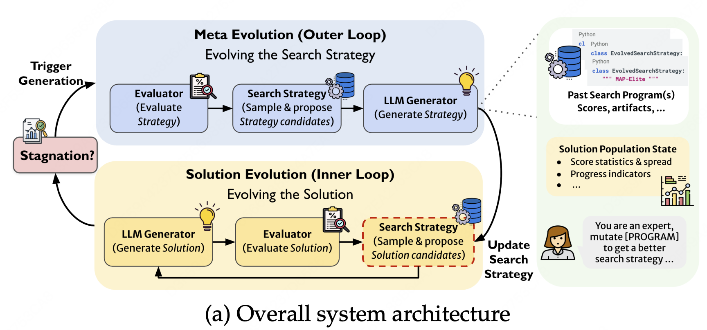
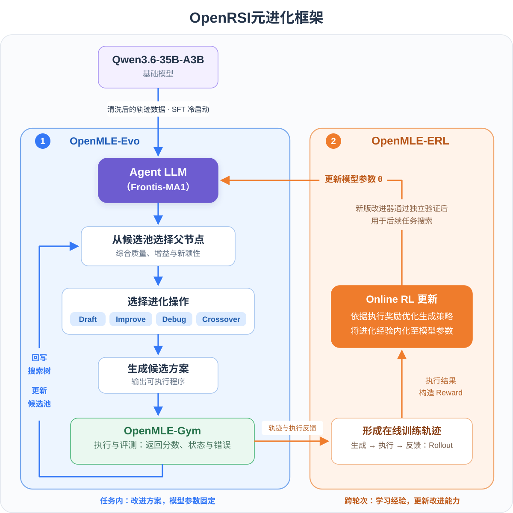
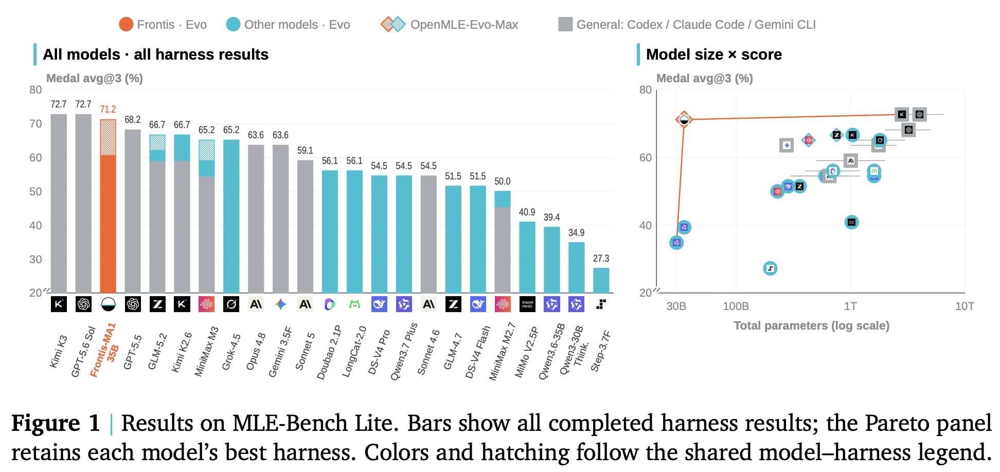
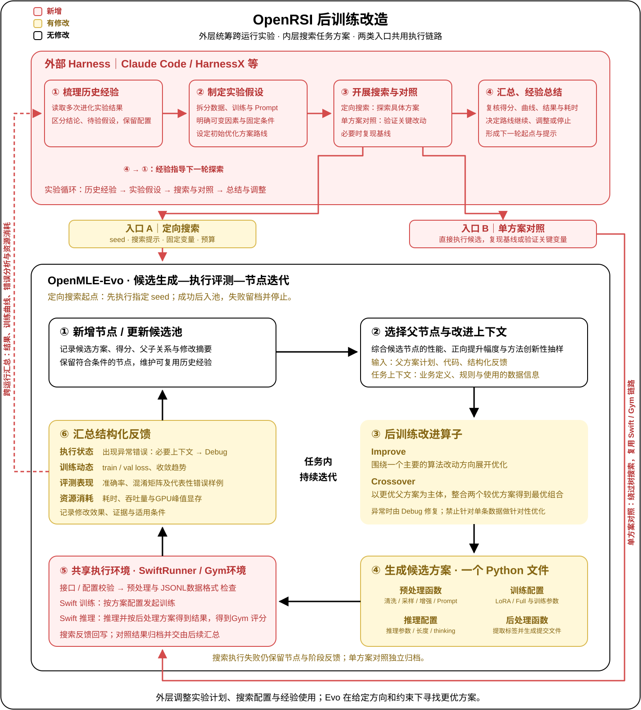

# 算法领域元进化(Meta Learning)实践

> 来源：[学城原文](https://km.sankuai.com/collabpage/2785845384) · 归档日期：2026-09-23 · 原文版本：`stepVersion=1`
>
> 本文为原文归档，未独立核实其中的技术判断与数据。阅读版将两张图片和两幅内嵌 SVG 改为仓库内引用；表格中的五段长代码按原始内容与缩进单独保存，可通过表格链接查看。
>
> [原始 Markdown 导出](source.md) · [原始 CitadelXML](source.xml) · [归档元信息](metadata.json) · [文档目录](../../README.md)

## 一、背景

**元进化（Meta-evolution）是将“Agent 如何进化”本身作为持续优化对象的过程，目标是从多轮改进过程中优化更有效的进化方法。** 自进化主要利用任务经验更新 Prompt、Skill、Memory、工作流或模型参数；元进化则进一步根据历史改进结果，调整“应该优化什么、采用什么策略，以及何时改变方向”，提高后续进化的质量与效率。

两者的核心区别在于优化对象：**自进化改善任务能力，元进化改善进化的机制。** 类比元学习的“学习如何学习”，元进化可以理解为“学习如何更有效地进化”。

以 EvoX[^ref-1] 为例，元进化通常通过两个相互反馈的循环实现。

- **任务进化内环**：按照当前搜索策略选择父代与参考解，生成并执行新方案，将结果与反馈写回候选库，持续优化任务解法。
- **元进化外环**：根据一段搜索过程的进展与历史经验，调整父代选择、参考解组合和进化方式等策略，再用新策略指导后续搜索。

**内环产生进化经验，外环利用经验更新进化机制，更新后的机制再推动内环迭代。** 两者协同，使系统在积累更优任务方案的同时，也能够提高每次进化的效果。

## 二、OpenRSI介绍

### 2.1 项目摘要

OpenRSI [^ref-2]是由清华大学研究者提出的一个元进化框架**，**提出了面向机器学习算法任务的元进化模型 **Frontis-MA1** 及其完整技术框架 **OpenMLE**[^ref-3]，目标是探索 **AI 如何通过执行反馈持续改进 AI 系统，并进一步走向递归自我改进(RSI，recursive self-improvement)**。

### 2.2 算法流程

OpenRSI 通过 **OpenMLE-Gym、OpenMLE-Evo 和 OpenMLE-ERL** 三个模块，将任务执行、方案搜索与模型学习连接起来：Gym 提供可信反馈，Evo 利用反馈寻找更优方案，ERL 将改进经验转化为模型能力，形成“**搜索积累经验—经验训练模型—模型驱动后续搜索**”的元进化路径。

整体流程包含两个相互连接的循环：**任务级快环优化当前方案，模型级慢环提升Agent LLM能力****。** 图中蓝色回路表示方案搜索与迭代，橙色回路表示经验学习与模型更新。

<!-- HTML 内容 -->

**（1）OpenMLE-Gym：执行方案，提供方案反馈**

Gym 将机器学习任务封装为标准任务包，提供统一的任务接口和隔离执行环境。Agent 生成可执行的候选程序后，由 Gym 完成运行与评测，并返回任务得分、日志和异常信息，为方案改进提供依据。

**（2）OpenMLE-Evo：组织搜索，持续改进方案**

Evo 通过搜索树记录候选方案、执行结果及父子关系，并维护候选池，为后续迭代选择父方案和参考经验。父节点选择综合考虑**当前质量、相对增益与方法多样性**，兼顾高价值方案的深化和新方向的探索。

搜索由四类操作组成：**Draft** 生成初始方案或探索新路线，**Improve** 改进已有方案，**Crossover** 组合不同方案的有效部分，**Debug** 修复执行错误。候选经 Gym 执行后，反馈重新进入搜索树，驱动下一轮迭代。

**（3）OpenMLE-ERL：学习改进经验，更新模型能力**

ERL 将经过筛选的候选方案、修改过程与执行反馈转化为训练信号，通过 **Online RL** 更新 Agent LLM，使模型逐步掌握更有效的生成、改进、组合与修复策略。搜索经验由此从外部记录转化为模型参数中的改进能力，再用于后续任务。

**三个模块共同形成双层闭环：**

- **任务级快环：** Agent LLM 参数保持固定，Evo 组织候选生成，Gym 执行并返回反馈，在给定预算内持续寻找更优方案。
- **模型级慢环：** ERL 汇集跨任务的改进轨迹，训练新的 Agent LLM，再将其用于后续搜索，提升产生有效改进的能力。

**快环产出更好的任务方案和改进经验，慢环利用这些经验训练更强的改进器，两者通过执行轨迹与模型更新连接起来。**

### 2.3 实验结果

论文的主实验结果如图所示：

在 MLE-Bench Lite 上，Frontis-MA1-35B + OpenMLE-Evo-Max 已超越部分顶尖模型与工业级 Harness 的组合，并接近领先闭源系统的表现。

## 三、业务场景实践

> **ℹ️ 信息：**
>
> 本次实践将OpenRSI框架应用于匹配算法场景，将框架从“传统ML模型进化”改造为“LLM后训练模型进化”，可以自动进行LLM模型训练方案的候选生成、训练、评测，并以树搜索的形式迭代进化。在酒旅房型匹配场景中展开初步实验，对比了不同api大模型、人工baseline、Autoresearch的结果，并取得了初步的实验效果。

### 3.1 业务场景：酒旅住宿境内竞对房型匹配

**数据：**训练集共21913条，测试集共2903条，数据样例为：

|   | outer_room_name | mt_room_name | label |
| --- | --- | --- | --- |
|   | 园景·两室一厅套房（私享浴缸+阳台+厨具齐全） | 中式观海.两室一厅（私人浴缸+开放式厨房） | 否 |
|   | ZOWEI电竞观影双人套房（卓威400HZ显示器+4070S显卡+32G内存+65寸观竞电视+网吧特权） | 电竞观影双床套房 | 是 |
|   | 归谧\|静谧双床房\|私人庭院\|巨幕投影\|零压床垫\|mini冰箱\|智能马桶 | 慢岛丨海景静谧双床房 | 否 |

**评价指标：**BadCase率

**对比基线：**人+agent的线上方案BadCase率6.27%

### 3.2 业务场景的改造适配

**适配的核心是将 OpenRSI 的搜索对象，从通用机器学习程序扩展为大模型后训练方案。** 结合 ms-swift 封装统一的训练与推理接口，让 Agent 聚焦影响效果的数据处理逻辑与训练配置，降低生成代码的复杂度。主要改造包括：

**（1）规范候选方案，打通后训练执行链路**

每个候选方案仍是 Python 文件，但无需自行实现完整的模型加载、训练与推理流程，只需提供四部分内容：数据预处理函数、训练配置、推理配置和数据后处理函数。同时扩展 Gym 任务包，串联“**数据准备 → Swift 训练 → 模型选择 → Swift 推理 → 后处理 → Gym 评分**”。各阶段记录运行结果与异常，使 Agent 既能调整方案，也能根据失败阶段定位问题。

**（2）优化面向后训练的operator提示词**

重写 Improve、Crossover 提示词，覆盖数据处理、Prompt、监督形式、训练策略。**Improve** 强调基于case分析和上一轮反馈、围绕几个算法优化策略提出改动；**Crossover** 强调以较优方案为主体，整合另一方案中的有效机制。同时可以复现已有人工最优方案，成功后作为初始节点，继续通过 Improve、Crossover 优化。

**（3）将执行日志转化为结构化反馈**

从日志中提炼**执行状态、训练动态、评测表现和资源消耗**，并记录相对父方案的修改及效果变化。在有限上下文预算内保留关键信息和代表性错误，帮助模型定位问题、形成假设并优化下一轮方案。

<!-- HTML 内容 -->

### 3.3 OpenRSI+外部harness

在当前使用方式下，OpenRSI 主要围绕单次运行的搜索树进化。这种机制存在三方面局限：

- **跨搜索经验不共享。** 不同运行的搜索记录相互独立，已尝试的方向和失败方案难以被后续运行直接复用，容易产生重复探索。
- **树内搜索容易停留在局部调整。** 同一次搜索可能持续围绕同类策略修改，得分虽有波动，却缺少新的突破方向。
- **节点反馈难以支撑跨实验决策。** 单次后训练成本较高，需要判断收益来自算法改动还是执行条件，哪些变量需要单独验证、哪些路线值得继续，这些判断依赖多轮结果，超出了父代选择和搜索树的作用范围。

外部 Harness 负责统筹多轮实验，决定探索什么；OpenRSI 负责在给定方向与约束下搜索更优方案。外层Harness的三个主要功能：

| 环节 | 功能 |
| --- | --- |
| 定向搜索 | 设置初始方案、搜索提示、固定变量与资源预算，调用 OpenRSI 探索具体解法 |
| 单方案对照 | 直接运行候选，验证关键假设或复现基线，与OpenRSI共用 Swift / Gym 验证环境 |
| 汇总、经验总结 | 整合实验结果与错误分析，沉淀有效策略、负结果及适用条件，指导后续搜索 |

每轮按照“**梳理经验 → 制定假设 → 搜索与对照 → 总结与调整**”推进：从历史记录中确定待验证方向，明确变量与预算，开展搜索和必要对照，再结合效果与成本决定继续、调整或停止，并更新下一轮的起点、提示与约束。

外部 Harness 由此承担类似元层的作用，调整的是**实验计划、搜索配置与经验使用方式**，使多次独立运行形成可积累、可调整的持续探索过程。

### 3.4 实验结果

基于Qwen3.5-4B模型，在使用不同的API作为Agent LLM下，在酒旅境内竞对房型匹配场景进行试验，实验结果及结论如下：

**结论1：元进化探索（RSI）范式整体优于人工调优与 AutoResearch 自动探索，能获得更优的模型效果**（实验2/实验3/实验4/实验5 vs 实验0/实验1）

**结论2：对业务知识的理解深度决定探索收敛的方向与上限，“****知识注入****”是探索效果的增益项**（实验2 vs 实验3/实验4）

**结论3：引入“专家”模型承担探索的全局调度与指导，能够帮助探索跳出局部最优**（实验5 vs 实验4）

| 序号 | 实验名称 | 模型名称 | 实验方案描述 | BadCase率 | 备注 |
| --- | --- | --- | --- | --- | --- |
| 实验0 | 人工 | Qwen3.5-4B | 全参微调，使用与线上模型相同的prompt模版，在codelab中训练。 | 6.27% |  |
| 实验1 | AutoResearch | Qwen3.5-4B | Autoresearch生成的实验记录：[Autoresearch实验记录](https://km.sankuai.com/collabpage/2781933082) | 6.65% |  |
| 实验2 | RSI-LongCat2.0 | Qwen3.5-4B | 全参微调，prompt优化重写，prompt中加入few-shot样例。  [查看完整代码（Python）](code/01-experiment.py) | 5.61% |  |
| 实验3 | RSI-kimi-k3 | Qwen3.5-4B | 全参微调，使用数据增强：根据匹配规则通过关键词替代构造样本1w条。 | 6.10% |  |
| 实验4 | RSI-GLM5.2 | Qwen3.5-4B | 全参微调，关键词匹配判定困难样本，并做上采样数据增强。 | 6.20% |  |
| 实验5 | Claudecode+RSI-GLM5.2 | Qwen3.5-4B | 数据上采样+LoRA微调  [查看完整代码（Python）](code/02-experiment.py)  | 5.99% | 实验记录：[cc+RSI实验记录](https://km.sankuai.com/collabpage/2783251887)，使用Claudecode掌握全局视野调度OpenRSI进行探索，进行实验36次，效果最好的Badcase率5.99%。 |

如表所示，当前元进化探索已获得优于现有人工方案的候选解法，初步验证了其在后训练方案优化中的效果。

其中，不同的模型可能使用了同样的策略，但是具体实现方式不同，结果也不同，这与模型在搜索过程中的自主决策有关。比如同样做数据增强的几个方案：

| 模型 | 模型名称 | 实验方案 | Badcase率 |
| --- | --- | --- | --- |
| RSI-GLM5.2 | Qwen3.5-4B | 全参微调，对所有正样本进行 2 倍过采样，同时根据规则关键词筛选困难负样本并进行 2 倍上采样。  [查看完整代码（Python）](code/03-experiment.py) | 6.20% |
| RSI-LongCat2.0 | Qwen3.5-4B | 全参微调；prompt 压缩，对所有正样本进行 2 倍过采样。  [查看完整代码（Python）](code/04-experiment.py) | 7.85% |
| RSI-kimi-k3 | Qwen3.5-4B | 全参微调，使用规则驱动的数据增强：根据房型匹配规则构造最多约 1.2 万条增强样本。  [查看完整代码（Python）](code/05-experiment.py) | 6.10% |

## 四、后续规划

**1.  扩展搜索空间，优化算子调度**

在超参数与数据采样优化的基础上，拓展长尾难例重采样、负样本挖掘、多阶段训练，以及 DPO、GRPO、OPD 和大小模型协同等优化方向，推动搜索从局部配置调整扩展到训练方法与模型协作方式。同时，结合节点反馈和搜索进展，动态调整 Draft、Improve、Debug、Crossover 等算子的选择概率，兼顾新方向探索与高价值方案深化，减少无效尝试。

**2. 推动跨场景复用与自动化运行**

将房型匹配实践中的任务定义、数据处理、训练配置与反馈内容标准化，形成可配置、可复用的实验模板，逐步推广至其他匹配业务场景。打通任务调度、训练、评测与结果归档流程，完善预算控制和异常恢复机制，降低人工干预成本，支持后训练实验的常态化无人值守运行。

**3.构建领域 ERL 闭环，提升模型自主改进能力**

汇集树搜索与外部 Harness 的实验记录，筛选高质量的“假设—实验—诊断—修复”轨迹，形成可复用的改进器训练数据。基于这些轨迹开展 Agent LLM 的 SFT 与 Online RL，将有效的调优经验和 Debug 策略内化到模型参数中，并将训练后的改进器用于后续搜索，逐步减少对外部引导的依赖，提高方案生成有效率与单位预算收益。

---

**注释：**

- EvoX：EvoX: Meta-Evolution for Automated Discovery[https://openreview.net/pdf?id=puRQNPwKs1](https://openreview.net/pdf?id=puRQNPwKs1)
- OpenRSI ：[https://arxiv.org/abs/2607.28568](https://arxiv.org/abs/2607.28568)
- OpenMLE：[https://github.com/FrontisAI/OpenRSI](https://github.com/FrontisAI/OpenRSI)

[^ref-1]: EvoX：https://openreview.net/pdf?id=puRQNPwKs1
[^ref-2]: OpenRSI：https://arxiv.org/abs/2607.28568
[^ref-3]: OpenMLE：https://github.com/FrontisAI/OpenRSI
