# Agent 上下文工程：构成、诊断与解法

> 来源：[学城原文](https://km.sankuai.com/collabpage/2786220186) · 归档日期：2026-09-23 · 原文版本：`stepVersion=4`
>
> 本文为原文归档，未独立核实其中的技术判断与数据。阅读版将八张图片改为仓库内引用。五幅 HTML 图同时提供离线预览与原始文件；表格内三段示例按原始内容单独保存。
>
> [原始 Markdown 导出](source.md) · [原始 CitadelXML](source.xml) · [归档元信息](metadata.json) · [文档目录](../../README.md)

> 📑 **文档目录**

> **💡 提示：**
>
> 本文讨论 Agent 的上下文工程，首先以 CatPaw 和 ClaudeCode 为例，拆解一次 LLM API 请求的上下文中装了什么；再逐一讨论三类输入的设计 —— 全局信息文件、SKILL 和工具；接着给出判断一次任务执行失败是不是上下文问题的方法；最后给出上下文问题的解空间 —— 其中三种解法来自我们的领域 Agent 实践，另外两种来自业界方法论。

### 一、上下文包含哪些内容

#### 1.1 以 CatPaw 为例分析

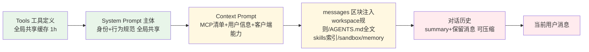

根据当前 CatPaw 的使用，上下文的构造基本如上图所示

|   | 详细描述 |
| --- | --- |
| **Tools（工具定义）** | 全部工具的 JSON Schema（服务端工具如 fetch_rules/km_search + 沙箱工具如 read_file/grep + MCP 工具 + 业务自定义工具），这是最稳定的前缀，官方架构文档称其「永不被压缩」，配 1h TTL 缓存断点。 |
| **System Prompt 主体** | CatPaw 的身份定义、行为规范（中文回复、格式约束、拒答规则、心理健康关怀等）、工作区规则、工具使用规范（TodoWrite/子 Agent/web 限制）、Skill 保护条款、记忆系统路由规则。所有用户共享同一份，享受服务端共享前缀缓存。 |
| **Context Prompt（运行时状态）** | 用户信息（MIS、OS、日期、workspace 路径）、CatDesk 客户端能力（图片渲染、automation directive 格式等）。 |
| **messages 尾部逐次注入的项目级区块** | - `<always_applied_workspace_rules>`——AGENTS.md/CLAUDE.md 全文（实验确认两种文件名都识别，全文装载） - `<agent_skills>`——全部 skill 的名称+触发描述，正文按需 Read，两段式懒加载 - `<sandbox_context>`——沙箱模式、浏览器工具替代规则、下载通道、危险命令禁令 - `<memory_context>`——MEMORY.md 全文 |
| **对话历史** | （user/assistant/tool 消息，含摘要），压缩时切成「summary + 保留消息」，切分点回溯保证 tool_use/tool_result 不拆开。 |
| **当前用户消息** | 每次不同，永不缓存。 |

> **📂 折叠块（默认折叠）：Anthropic 在 effective-context-engineering-for-ai-agents 中的论述**
>
> | **英文** | **中文** |
> | --- | --- |
> | System instructions / System prompts | 系统指令 / 系统提示 |
> | Tools | 工具 |
> | Model Context Protocol (MCP) | 模型上下文协议 |
> | External data | 外部数据 |
> | Message history | 消息历史 |
> | Examples (Few-shot examples) | 示例 / 少样本示例 |
> | Intermediate results / Agent-generated data | 中间结果 / Agent 生成的数据 |

> **📂 折叠块（默认折叠）：Philipp Schmid（前 Hugging Face、前 Amazon 资深 AI 工程师），上下文不只是你发给 LLM 的那条提示词，而是模型生成回复前看到的所有东西。具体包括：**
>
> 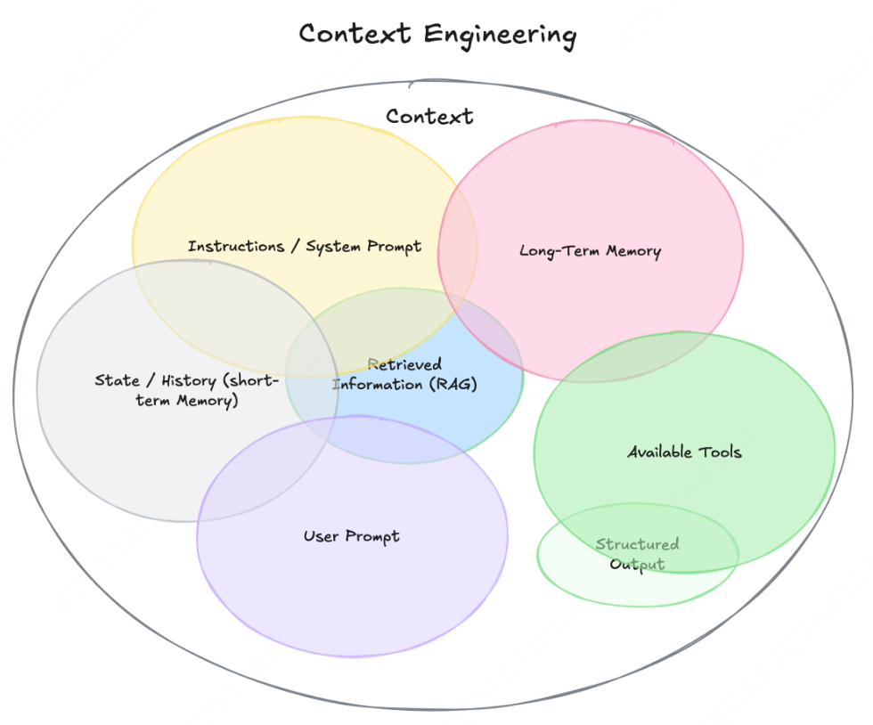
>
> 1. Instructions / System Prompt（系统提示词）
> 2. User Prompt（用户提示词）
> 3. State / History, short-term Memory（状态/历史，短期记忆）
> 4. Long-Term Memory（长期记忆）
> 5. Retrieved Information, RAG（检索信息，RAG）
> 6. Available Tools（可用工具）
> 7. Structured Output（结构化输出定义）

> **📂 折叠块（默认折叠）：Google 白皮书《Context Engineering: Sessions, Memory》**
>
> [Google 白皮书《Context Engineering: Sessions, Memory》](https://blog.csdn.net/weixin_40877874/article/details/156618119)
>
> 指导准绳的上下文：定义智能体的基本推理模式和行动方式，决定其行为：
> 　• 系统指令（System Instructions）：定义智能体角色、能力和具体的限制指令。
> 　• 工具定义（Tool Definitions）：解释每个外部执行交互的 API 或函数。
> 　• 少样本示例（Few-Shot Examples）：通过上下文学习指导模型理解过程的表达示例。
>
> 证据与事实数据：智能体理解任务的事实依据，包括相关知识和外部实时信息，是智能体响应的“证据”：
> 　• 长期记忆（Long-Term Memory）：跨多个会话收集的关于用户或任务的持久化知识。
> 　• 外部知识（External Knowledge）：从数据库或文档中检索的信息，通常通过检索增强生成（RAG）实现。
> 　• 工具输出（Tool Outputs）：工具调用数据或结果。
> 　• 子智能体输出（Sub-Agent Outputs）：被委托特定任务的专业智能体返回的结论或结果。
> 　• 工件（Artifacts）：与用户或智能体相关的文件或数据（如文件、图像）。
>
> 即时过程信息：让智能体知道当前交互、定义时序：
> 　• 对话历史（Conversation History）：当前交互的轮次记录。
> 　• 状态/草稿（State / Scratchpad）：智能体用于即时推理或任务状态跟踪的临时信息。
> 　• 用户提示（User’s Prompt）：需要处理的即时查询。

结合当前 CatPaw 和业界理解，上下文中内容包括：**指导信息**（系统提示、工具定义、少样本示例、skill名称和触发描述）、**证据与事实数据**（长期记忆、外部知识、工具输出、Agent输出的中间结果）、**即时过程**（对话历史、用户提示）。其中工具定义当前主要以CLI封装在skill里面为主，因此后续不单独针对这块做讨论，感兴趣可参考附录1。少样本示例在长上下文中占比较小，也暂不做讨论。长期记忆、外部知识的召回，由知识管理部分的知识召回来解决，Agent 输出的中间结果主要由平台运行时决定。用户输入的 Prompt 在长任务下占比较少，可以参考附录2。接下来重点对全局文件、Skill、工具、上下文工程实践做重点讨论。

#### 1.2 以 ClaudeCode 为例分析

用一次实际 Agent 调用查看这个构成。以“查一下这周的定向采集完成情况”这个问题为例。

 单个 turn 共 31 次 LLM API 调用，第一次请求的上下文约 5.25 万 token，其中 System 数组 3k token、Tools 数组 3.1 万 token、messages 1.9 万 token。之后每轮请求新增 3 组消息（上一轮响应 + 工具执行结果 + 系统提醒），31 轮下来上下文涨到 8.85 万 token，增量的 90% 以上来自工具输出 —— 两次最大的单轮增量都是文件内容入场（skill 全文 7.7k token、知识文件 9k token）。

> **📂 折叠块（默认折叠）：发送问题“查一下这周的定向采集完成情况”时的上下文信息构成**
>
> **A. 请求元信息**
>
> | 字段 | 值 |
> | --- | --- |
> | url | [https://mcli.sankuai.com/v1/messages?beta=true](https://mcli.sankuai.com/v1/messages?beta=true) |
> | model | `claude-opus-5` |
> | max_tokens / stream | 64000 / true |
> | thinking | `{"type": "adaptive"}` |
> | headers | `anthropic-beta: claude-code-20250219, context-1m, interleaved-thinking, prompt-caching...` |
>
> **B. System 数组（3 个 block，共 13,325 字符）**
>
> | # | 字符数 | cache_control | 内容 |
> | --- | --- | --- | --- |
> | [0] | 70 | 无 | 计费头 `x-anthropic-billing-header: cc_version=2.1.247...` |
> | [1] | 57 | ephemeral | 身份行 "You are Claude Code, Anthropic's official CLI for Claude." |
> | [2] | 13,198 | ephemeral | **主系统提示词**：Output Style 规则、工具使用规范、环境信息（cwd、分支）、git status 快照等 |
>
> **C. Tools 数组（32 个工具定义，以 ClaudeCode Harness 为例）**
>
> 30 个内置工具 + 2 个 MCP 工具，每个工具都带完整 description 和 JSON Schema，体积可观约13万字符，是 prompt caching 的主要受益对象。
>
> | 工具 | description 字符 | schema 字符 | 合计 |
> | --- | --- | --- | --- |
> | `Artifact` | 16,162 | 10,648 | 26,810 |
> | `Workflow` | 19,290 | 1,818 | 21,108 |
> | `DesignSync` | 3,724 | 5,393 | 9,117 |
> | `Monitor` | 6,132 | 1,246 | 7,378 |
> | `SendMessage` | 3,934 | 2,254 | 6,188 |
> | `SendFeedback` | 3,467 | 2,023 | 5,490 |
> | `AskUserQuestion` | 1,786 | 3,149 | 4,935 |
> | `ScheduleWakeup` | 3,396 | 1,423 | 4,819 |
> | `EndConversation` | 4,500 | 126 | 4,626 |
> | `EnterPlanMode` | 4,011 | 126 | 4,137 |
> | `EnterWorktree` | 3,220 | 703 | 3,923 |
> | `CronCreate` | 2,595 | 907 | 3,502 |
> | `Agent` | 1,811 | 1,656 | 3,467 |
> | `Bash` | 1,056 | 1,426 | 2,482 |
> | `ExitWorktree` | 1,923 | 502 | 2,425 |
> | `ExitPlanMode` | 1,849 | 537 | 2,386 |
> | `ReportFindings` | 574 | 1,636 | 2,210 |
> | `Skill` | 1,417 | 345 | 1,762 |
> | `PushNotification` | 1,362 | 351 | 1,713 |
> | `NotebookEdit` | 619 | 981 | 1,600 |
> | `Read` | 790 | 776 | 1,566 |
> | `TaskOutput` | 1,049 | 465 | 1,514 |
> | `ListAgents` | 777 | 336 | 1,113 |
> | `Edit` | 360 | 584 | 944 |
> | `WebSearch` | 309 | 499 | 808 |
> | `TaskStop` | 378 | 382 | 760 |
> | `WebFetch` | 374 | 336 | 710 |
> | `Write` | 240 | 367 | 607 |
> | `mcp__ide__executeCode` | 363 | 226 | 589 |
> | `CronDelete` | 100 | 219 | 319 |
> | `mcp__ide__getDiagnostics` | 37 | 255 | 292 |
> | `CronList` | 60 | 126 | 186 |
> | **合计（32 个工具）** | **87,665** | **41,821** | **129,486** |
>
> **D. Messages 数组（5 条消息，约 58k 字符）**
>
> 这是上下文的主体。注意此刻用户刚刚发出问题，messages 里已经装了 5 条：
>
> | # | role | 字符数 | 内容 | p.s. |
> | --- | --- | --- | --- | --- |
> | [0] | user | 24,158 | **CLAUDE.md 注入**：以`<system-reminder>` 形式注入全局 + 项目级别的`CLAUDE.md` + currentDate | cc 的 harness，在会话第一条用户消息前，自动把一堆配置文件包裹成 <system-reminder> 塞进去，包含： - [claude.md](http://claude.md) - [memory.md](http://memory.md) - currentDate |
> | [1] | system | 32,403 | available agent + skill descriptions |   |
> | [2] | assistant | 402 | 上一轮问题的回答（含 thinking + text） |   |
> | [3] | user | 15 | **用户问题本身**："查一下这周的定向采集完成情况." |   |
> | [4] | system [自定义] | 581 | **UserPromptSubmit hook 注入**：output-style 提示 + `<ANCHOR>` 持续守则 | Anchor 插件作用处 |

<!-- HTML 内容 -->

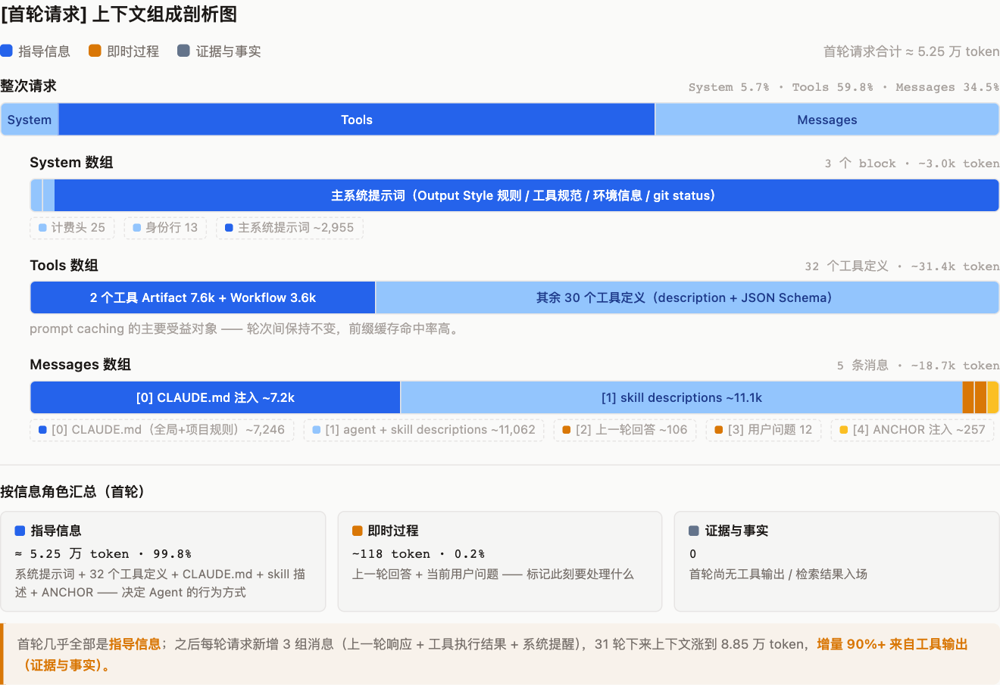

[查看原始 HTML](../../../assets/citadel/2786220186/diagram-01.html)


### 二、全局信息文件

本章节讨论的全局信息文件，指在会话启动时整体注入的指导信息，如：User Prompt（区别于 System Prompt）、AGENTS.md、CLAUDE.md等。这些文件直接决定 Agent 的基本行为方式，是上下文重要的组成部分。以 AGENTS.md 为例，OpenAI 的理解是：

> “Give Codex a map, not a 1,000-page instruction manual”[^archive-ref-1]

他们尝试过一个巨大的 `AGENTS.md`，但失败了，原因有四个：

- 上下文是稀缺资源。巨型指令文件会挤占任务描述、代码和真正相关文档的位置，导致 Agent 忽略关键限制，错误方向优化；

- 过多指导会变成“无指导”。当所有内容都标为重要时，没有内容真正重要；

- 文档会迅速腐化，单体手册很容易累积过时规则。Agent 无法判断哪些还有效，人类也会逐渐停止维护；

因此他们的方案是：

> “So instead of treating AGENTS.md as the encyclopedia, we treat it as the table of contents.”

即不把 `AGENTS.md` 当百科全书，而把它当目录页。OpenAI 的 `AGENTS.md` 大约 100 行，只提供稳定入口和到深层知识源的指针；真正的知识库放在仓库内结构化的 `docs/` 目录中，包括设计文档、产品规格、执行计划、架构说明、质量指标、安全规范等。这样实现了“渐进式披露”（progressive disclosure）：Agent 从一个小而稳定的入口开始，按需逐层深入，而不是在开始时就被海量信息淹没。

```
// AGENTS.md 示例
AGENTS.md
ARCHITECTURE.md
docs/
├── design-docs/
│   ├── index.md
│   ├── core-beliefs.md
│   └── ...
├── exec-plans/
│   ├── active/
│   ├── completed/
│   └── tech-debt-tracker.md
├── generated/
│   └── db-schema.md
├── product-specs/
│   ├── index.md
│   ├── new-user-onboarding.md
│   └── ...
├── references/
│   ├── design-system-reference-llms.txt
│   ├── nixpacks-llms.txt
│   ├── uv-llms.txt
│   └── ...
├── DESIGN.md
├── FRONTEND.md
├── PLANS.md
├── PRODUCT_SENSE.md
├── QUALITY_SCORE.md
├── RELIABILITY.md
└── SECURITY.md
```

### 三、Skill

本章节讨论 Skill 的设计。Skill 对上下文的影响可以分成两层：一方面，Skills 的名称和描述以较高优先级注入上下文，作用约等于一份全局文件；另一方面，Skill 的正文按需加载，其内容质量往往直接决定 Agent 能否按预期完成任务。

**Skill 的设计**

**渐进式披露****（Progressive Disclosure）**是 Skill 灵活可扩展的核心设计原则 —— 就像组织良好的手册从目录开始、再到具体章节、最后是详细附录，Skill 让 Agent 按需加载信息，无需将整个 Skill 内容读入上下文窗口，因此 Skill 中可捆绑的上下文量实际上是无限的。Skill 的设计可分为三层：

- YAML 元数据（name + description）：必须包含名称和描述，会话初始化时，所有的 Skills 的这部分信息会加载到上下文中（如 1.2 中的分析，该部分位于 Messages 数组 中）
| 名称（name） | 描述（description） |
| --- | --- |
| Skill 的命名建议使用小写连字符格式，例如（skill-creator）。不推荐使用下划线或驼峰命名，如：skill_creator 或 skillCreator | Skill 的描述部分应包含三要素：能力概述 + 触发条件 + 排他边界 应当注意该部分内容的长度，适中为宜 |
- 正文（SKILL.md）：这是核心的执行指令层，包含 Agent 完成任务所需的步骤和规则。
|  | 建议规范 | 详细内容 |
| --- | --- | --- |
|  | 控制正文规模，坚持渐进式披露 | 建议 SKILL.md 正文应控制在 500 行（2~3k tokens）以内，若超出该长度可以考虑按功能点拆分为子 Skills，由 SKILL.md 负责整体描述和能力路由。 |
|  | 前置检查写在前面，并规定处理策略 | 任何依赖外部工具、CLI 或认证状态的 Skill，都必须在正文开头写明前置检查步骤，并明确检查失败时的处理动作，减少让 Agent 在后续步骤中遭遇隐性失败。<br> [查看完整示例](code/01-example.txt)  |
|  | 意图路由显式化 | 对于复杂使用场景和多功能的 Skills 能力体系，在 SKILL.md 中引用文件时，应当建立一份明确的路由表（使用契约）。<br> [查看完整示例](code/02-example.txt) |
|  | 编排流程和知识文件解耦 | SKILL.md 正文只写“编排”，如：流程步骤、路由规则、前置检查、调用契约等。知识文件如果体量较少可以下沉到 references/ 知识文件夹中，如果体量大可以使用外挂知识库能力（如 llm-wiki 式的 skill rag）。SKILL.md 只需说明知识使用方式和存储路径。 |
- 关联文件：当 Skill 承担的任务较为复杂时，可在目录中制作不同的文件夹供 Agent 在使用该 Skills 时按需获取。
| 建议规范 | 详细内容 |
| --- | --- |
| 目录结构 | [查看完整示例](code/03-example.txt) |

**Skill 中的知识组织方法**

<span style="color:rgb(62, 62, 62)">**什么时候该拆文件？**</span><span style="color:rgb(62, 62, 62)"> 一条经验法则：当一个文件超过 300 行，或某个 Step 的规则超过 100 行时，就是拆分信号。文件太长不光浪费 token，还会让 Agent 的注意力在大段文本中迷失。</span><span style="color:rgb(62, 62, 62)">**如何组织知识分层？根据使用频率对知识进行分层组织。**</span><span style="color:rgb(62, 62, 62)"> 越频繁用到的知识，离入口越近；越偶尔查阅的知识，越往深处放。这样 Agent 每次只加载当前步骤真正需要的内容，不会把上下文窗口塞满无关信息。实践中可以用一棵简单的决策树来判断：</span>

```
// skill组织方式判断
这段知识是否每次激活 Skill 都需要？
│
├── 是 ──→ 放 SKILL.md                       # 入口文件，每次激活必读
│
└── 否 ──→ 是否每次进入该模块时都需要？
           │
           ├── 是 ──→ 放模块主文件             # 如 creator.md（模块级入口）
           │
           └── 否 ──→ 是否仅在某个特定 Step 才需要？
                      │
                      ├── 是 ──→ 放对应的 phase 文件   # 如 collect-phase.md
                      │
                      └── 否 ──→ 是否只在特定条件下查阅？
                                 │
                                 ├── 是 ──→ 放参考文件       # 如 tools.md / safety.md
                                 │
                                 └── 否 ──→ 考虑是否需要保留  # 可能冗余 → 删除或合并
```

```
// 一个例子
trade-ab-skill/
├── SKILL.md             ← 意图路由表、全局安全红线（每次激活必读）
├── modules/creator/creator.md           ← 创建流程 Step 编排、scenarioId 对照表（进入创建模块才读）
├── modules/creator/collect-phase.md     ← 参数填充的 11 项执行清单（仅 Step 2 才读）
├── modules/creator/validate-phase.md    ← 校验规则（仅 Step 3 才读）
├── modules/creator/tools.md             ← MCP 工具接口列表（调接口时按需查阅）
└── modules/creator/safety.md            ← 安全约束详细规则（validate 阶段按需加载）
```

**用脚本扩展 Skills 的能力边界**

<span style="color:rgb(62, 62, 62)">**核心理念**</span><span style="color:rgb(62, 62, 62)">：将确定性计算逻辑封装为脚本，由 Agent 调用执行而非自行推导。脚本是 Skill 突破 LLM 能力边界的利器。</span><span style="color:rgb(62, 62, 62)">**什么时候需要写成脚本？**</span><span style="color:rgb(62, 62, 62)">如果这件事让 LLM 做有概率出错，但让脚本做能 100% 确定性完成，那就该封装成脚本。如果发现自己在 SKILL.md 中编写公式让 Agent 运行计算，该逻辑也应该被挪到脚本中。</span>

|   |   |   |
| --- | --- | --- |
| <span style="color:rgb(62, 62, 62)">场景</span> | <span style="color:rgb(62, 62, 62)">纯指令的局限</span> | <span style="color:rgb(62, 62, 62)">脚本的优势</span> |
| <span style="color:rgb(62, 62, 62)">配置文件读写</span> | <span style="color:rgb(62, 62, 62)">LLM 可能写入格式错误的 JSON</span> | <span style="color:rgb(62, 62, 62)">脚本保证格式正确，原子写入</span> |
| <span style="color:rgb(62, 62, 62)">环境检测</span> | <span style="color:rgb(62, 62, 62)">LLM 无法可靠检测系统状态</span> | <span style="color:rgb(62, 62, 62)">脚本直接查询，返回结构化结果</span> |
| <span style="color:rgb(62, 62, 62)">日志采集</span> | <span style="color:rgb(62, 62, 62)">LLM 不应直接处理网络请求</span> | <span style="color:rgb(62, 62, 62)">脚本封装 HTTP 调用，异常自处理</span> |
| <span style="color:rgb(62, 62, 62)">复杂计算</span> | <span style="color:rgb(62, 62, 62)">LLM 算术不可靠</span> | <span style="color:rgb(62, 62, 62)">脚本精确计算</span> |

<span style="color:rgb(62, 62, 62)">**脚本的设计遵循四个原则：**</span>

1. <span style="color:rgb(62, 62, 62)">自愈性——脚本内部处理所有异常，始终正常退出，绝不阻断 Skill 主流程</span>
2. <span style="color:rgb(62, 62, 62)">结构化输出——统一输出 JSON，方便 Agent 解析和流转</span>
3. <span style="color:rgb(62, 62, 62)">幂等性——多次执行结果一致，预检脚本只追加缺失项，不覆盖已有配置</span>
4. <span style="color:rgb(62, 62, 62)">安全边界——只操作指定文件，不触碰其他系统资源</span>

### 四、工具

**工具搜索工具****：**工具定义会大量消耗上下文，在我们 1.2 的例子中，工具定义占约 31k token。为 Agent 提供工具搜索工具，而非全量加载所用工具。该工具建设思路为：

1. 建设工具目录索引，把每个工具的“名称 + 描述 + 参数名 + 参数描述”拼接成文档
2. 拆分为常驻和非常驻，常驻工具集合无需搜索一直存在，非常驻工具集合登记进索引，通过工具搜索工具（search_tools）按需取出
3. 注入元工具代替非常驻工具集，形如：
```
// search_tools 工具示例
{
  "name": "search_tools",
  "description": "按任务需求检索可用工具。先用自然语言描述你要做什么，返回最匹配的工具定义。找不到时换关键词重试。",
  "input_schema": { "query": "string", "top_k": "int, default 5" }
}
```

**程序化工具调用****：**传统方式中，每次工具调用的中间结果都进入上下文（如日志查询文件），占用大量上下文空间，甚至触发输出截断。可由 Agent 生成脚本代码，在代码执行环境中批量调用工具（对应本文实践 6.5），只将最终结果输出写入上下文。

**返回有意义的上下文：**工具返回值应使用语义标识符而非加密标识符——用“2024年Q3规划会议”而非 `evt_2024_q3_001`，用 `username` 而非 `user_id_hash`。语义标识符让 Agent 无需额外查询就能理解上下文。文章还提出可控详细程度的响应格式模式：默认返回简洁模式（约 200 token），Agent 可以主动请求详细模式（约 600 token，多 3 倍），让 Agent 根据需要控制 token 消耗。

**优化 Token 效率：**Claude Code 工具响应默认上限 25,000 token，工具应远低于此限制。分页和过滤应是默认设置而非可选项。截断时应附带引导信息，比如“结果已截断，请使用更具体的查询来缩小范围”，引导 Agent 采用更好的策略。错误消息也是关键指导手段——差的错误消息 `{"error": "INVALID_PARAMS", "code": 400}` 给 Agent 的信息为零，好的错误消息应具体说明出错原因、提供正确格式示例，让 Claude 下次能修正。

| 检查类型 | 检查内容 |
| --- | --- |
| **返回值阶段** | 返回值是否使用语义标识符？ 是否有简洁/详细模式控制详细程度？ 响应是否默认分页/过滤？ |
| **错误处理阶段** | 错误消息是否具体说明了出错原因？ 错误消息是否提供了正确格式示例？ 截断消息是否引导 Agent 采用更好的策略？ |

### 五、上下文问题诊断：什么时候能判断可能是上下文的问题

#### **5.1 先判断：问题出在上下文的典型信号**

上下文问题的本质是「模型决策所需的信息，在采样时刻不在窗口里、被淹没了、或者是错的」。可以先看失败案例有没有这些特征：

**信息不在场（缺失）**：模型答非所问、编造事实、问已经告诉过它的事情。这时要问：这个信息真的在上下文里吗？很多时候是注入链路断了——子 Agent 的返回没拼进主 Agent 的 prompt、RAG 检索没命中、工具返回被截断。Anthropic 称之为 "dropped context"，是长时程任务最常见的失败模式。

**信息在场但被淹没（稀释）**：任务前半段表现正常，越跑越差；或者简单任务做对、上下文塞满后开始忽略早期指令。这就是 Context Rot（上下文腐烂）——token 越多，注意力预算被摊得越薄，回忆精度随长度梯度下降。典型信号是「早期指令被无视、后期工具结果被反复引用」。

**信息是错的（污染）**：上下文里有幻觉残留、过期的中间结论、甚至前面轮次的错误自我强化。子 Agent 架构里还有一类：上一步的失败信息被原样带入下一步，污染了后续推理。

**快速诊断思路**

-  同一个任务失败，换一个全新的干净上下文重新跑一次。新会话里轻松做对，大概率是上下文问题；干净上下文也错，多半是 Prompt/指令/流程设计/模型本身的问题
- 通过消息提醒，指引 Agent 拿到关键信息，观察纠偏后是否符合预期。若通过干预则回到正轨，大概率也是上下文的问题。

#### **5.2 再做验证：从业界实践中提炼的方法**

**1. Trace 分析（事后的第一步）**。把失败 case 的完整上下文在采样时刻 dump 出来，逐块检查四件事：关键信息在不在？在的话放在什么位置（头部/尾部/中间）？有没有相互矛盾的块？token 总量是多少？LangSmith、Langfuse、Braintrust 这类 LLM 可观测性平台的核心价值就在这——按 trace 回放每一轮的真实输入。

**2. 消融与注入实验（最硬的证据）**。这是验证「是不是上下文问题」的金标准，本质是控制变量：

- **加法实验**：在失败 case 的上下文里手动补上缺失的信息，重放。如果补上就对了，证明是信息缺失；补上还错，就不是上下文问题。
- **减法实验**：把无关内容删掉、只留最小充分集重放。如果瘦身后表现恢复，证明是稀释/腐烂。
- **位置实验**：同样的信息挪到上下文头部或尾部重放。表现随位置显著变化，说明是注意力稀释而非信息本身的问题。

要做重放（replay），前提是请求可复现：固定 model、temperature=0 或记录 seed、完整记录 messages 序列。

3. **基于 DeepSeek Harness 的会话分叉实验。**DeepSeek Harness 提供了一项能力：从会话的任意消息边界 fork 出一个新的会话，该会话后的所有内容被截断，把边界之前的完整上下文原样带入新会话继续执行。这本质上是截断重放，把它用作验证手段，可以对失败 case 做边界定位：

- **截断实验：**怀疑某个轮次引入了污染（错误结论开始自我强化）时，从该轮次之前 fork 重放。如果切掉后缀就恢复正常，证明问题确实出在被截断的段落；
- **二分定位：**对长会话多次 fork、逐步缩小边界，相当于对“上下文从哪里开始变质”做二分搜索——比整段 dump 审计更快收敛到失效点。

### 六、解决方案

围绕“如何让关键信息在 Agent 工作时都处于在场且被利用的状态”，本文梳理出如下五种解法，并给出上下文问题的解空间：

| 解法 | 做什么 | 来源 |
| --- | --- | --- |
| 6.1 上下文重置 + 结构化交接 | 定期换新会话，状态由外部工件承载 | Anthropic |
| 6.2 图状态持久化 + 节点局部上下文 | 状态外置，节点按需投喂最小切片 | LangGraph |
| 6.3 关键信息持续注入 | 不动结构，把关键信息抬到每条消息的关注高位 | 领域 Agent 实践（场景1-2） |
| 6.4 主子 Agent 流程编排 | 长流程切给多个独立上下文，交付物接力 | 领域 Agent 实践（场景3） |
| 6.5 固定任务剥离 + 微上下文流水线 | 将流程固定的批量任务从 Agent 自主执行剥离，转化为工具调用 | 领域 Agent 实践（场景4） |

一句话概括这些解法：注入是加[^archive-ref-2]、流程编排是拆[^archive-ref-3]、剥离是减[^archive-ref-4]、重置是换[^archive-ref-5]、外置是搬[^archive-ref-6]。其中，解法一、二来自业界方法论，解法三至五来自我们的领域 Agent 实践。

<!-- HTML 内容 -->
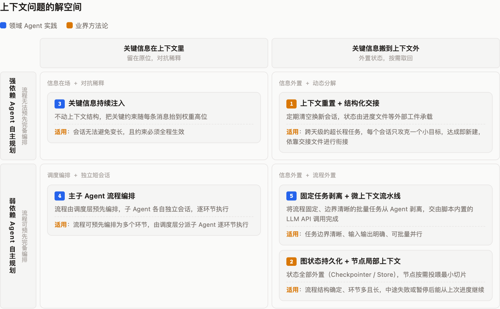

[查看原始 HTML](../../../assets/citadel/2786220186/diagram-02.html)

#### **6.1 Anthropic**** 给出的解法**：上下文重置 + 结构化交接

Anthropic 在长程任务的 harness 设计中给出了解法，可概括为「初始化一次，之后每轮增量执行，并用外部工件完成跨会话交接」，而不是让同一个 Agent 长期依赖上下文压缩、或指望它记住一份很长的流程说明。

- **Initializer Agent 搭好执行环境**：首轮不直接做业务，而是创建 `init.sh`（稳定启动环境）、`claude-progress.txt`（记录已完成事项与进度）、初始 Git 提交（固化初始文件状态）和一个结构化 feature list。
- **每轮 Coding Agent 固定执行“重新定位”**：看当前工作目录 → 读进度文件 → 读 feature list → 查 Git 日志 → 运行 init.sh → 先做基础端到端验证（确认环境未被上一会话留在损坏状态）；随后从未完成 feature 中选取最高优先级的一项，且一次只做这一项。
- **feature list 是防“提前收工”的机制**：把需求拆成可端到端验证的功能需求，每项初始标为 `passes: false`。后续 Agent 不允许随意改写、删除需求或测试，只能在充分验证后把状态改为通过。
- **验证通过才更新状态**：完成一个小功能后必须先做真实用户路径的端到端验证，通过后才把该 feature 置为 `passes: true`，写入进度文件并创建带描述的 Git commit —— 下一轮 Agent 通过「进度文件 + Git 历史 + 结构化功能清单」快速恢复工作，不必猜测前一轮发生了什么。

**与压缩的本质区别：**压缩把早期对话原地概括、保持同一 Agent 的连续性，但缩短的历史仍在同一上下文中继续膨胀，上下文焦虑[^archive-ref-7]无法消除；重置则提供全新状态，代价是交接的编排复杂度、token 开销和每次切换的延迟。

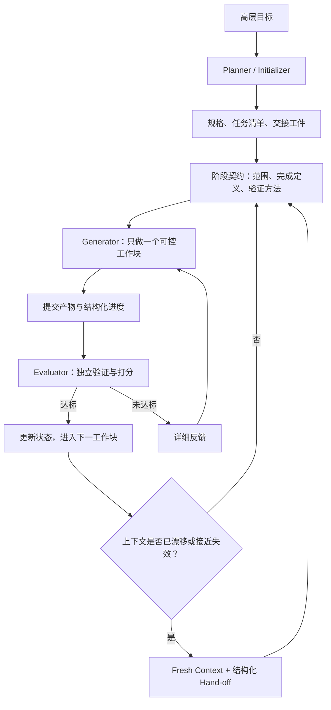

> **📂 折叠块（默认折叠）：点击展开内容**
>
> | **原始问题** | **Anthropic 的对应机制** |
> | --- | --- |
> | 上下文跨会话断裂，后续 Agent 不知道之前发生了什么 | `claude-progress.txt` 加 Git 历史作为交接工件 |
> | Agent 一次做太多，做到一半上下文耗尽 | 每轮只做一个 feature，要求 incremental progress |
> | Agent 过早宣布整个项目完成 | 用完整 feature list，所有功能初始为 `passes: false` |
> | 前一轮留下损坏、未文档化的环境 | 新会话先跑基础验证；旧会话结束前必须提交干净、可工作的状态 |
> | 模型虚假标记完成 | 只有经过端到端测试后才允许更新 `passes` |

#### **6.2 Langgraph 的解法**：图状态持久化 + 节点局部上下文

LangGraph 把这类长流程问题直接建模为「图状态的持久化执行」——不让模型记住整个过程，而是将执行过程显式拆成图（Graph）+ 节点（Node）+ 状态（State）+ 检查点（Checkpoint）。解决方案分四层：

- **用 Node 替代长 Skill 中的连续自然语言步骤**：一个 Node 只做一件事（读取需求 / 校验输入 / 检索知识 / 生成方案 / 独立评审 / 发布结果），边（Edge）与条件边定义状态转移 —— 原本 20k token Skill 里的流程长说明变成图结构的节点和边，模型在每个节点只获得本步骤真正需要的局部上下文。
- **State 存原始数据、不存格式化文本：**共享状态拆成原始且类型化的字段，每个节点按需从 State 选取字段、在自己的内部组装局部 prompt —— 状态存进 State ≠ 状态喂给模型：存储层收下全部字段，进入模型上下文的只有当前节点选取、裁剪后的最小切片。
- **Checkpointer + Store 两级持久化**：Checkpointer 保存单个线程的图状态快照，支撑当前长任务的断点续跑、人工审批与故障容错；Store 保存图状态之外的应用级数据——跨任务的领域知识、用户偏好、共享事实。

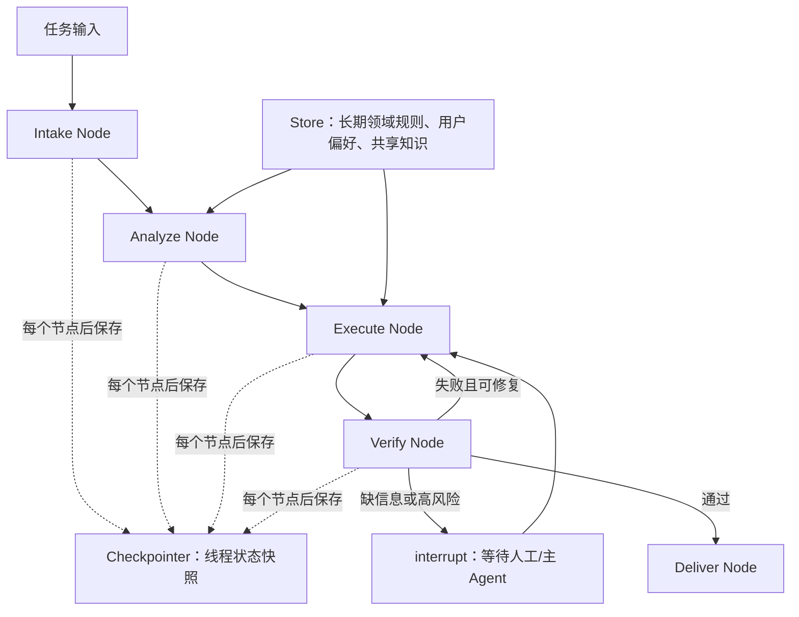

```
// 示例
短全局约束
→ 每个 Node 都注入。

流程步骤与阶段转移
→ Graph 的 Node / Edge / Conditional Edge。

当前任务状态、验证结果、重试次数、工件引用
→ Checkpointed State。

跨任务稳定知识、用户偏好、领域规范
→ Store / RAG。

本阶段详细规则和操作清单
→ 当前 Node 按需加载并组装成局部 prompt。

高风险动作、信息缺失、质量不确定
→ interrupt()，等待人工或主 Agent 的 Command(resume=...)。
```

#### 6.3 关键信息持续注入

<!-- HTML 内容 -->
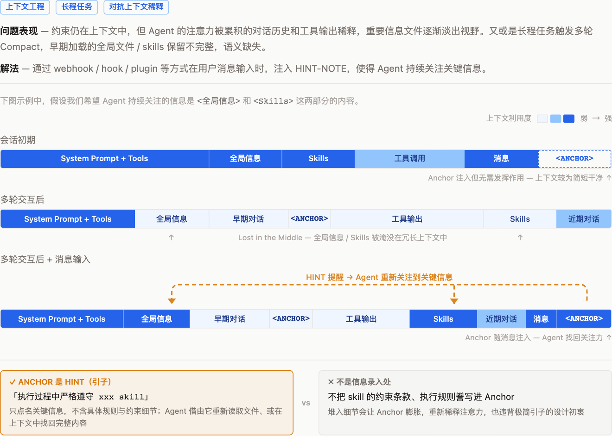

[查看原始 HTML](../../../assets/citadel/2786220186/diagram-03.html)


###### **场景一：到餐标注答疑 Agent**

**场景一特点：**全局文件和 Skills 文件在会话伊始即加载，随着用户的提问上下文持续膨胀，Agent 失去对早期加载的重要文件的关注度。

到餐标注答疑 Agent 依托 CatPaw Claw（群聊虾），部署在大象群聊中，为标注团队提供菜品匹配相关的实时答疑服务。群聊虾的行为主要依赖于两类约束文件：

- **Skills**：如 `knowledge-flow` skill，定义了检索协议的完整执行流程（切换知识库 → 读取检索协议 → 沿目录树导航 → 读取学城文档 → 基于文档内容作答）；
- **全局行为规则**：通过 `group-context-hook/AGENTS.md`在会话启动时注入，包括指定知识库为 `knowledge-biaozhu`、禁止使用 fallback 兜底检索、禁止凭上下文记忆直接回答等强制规则。

在上下文较短时，这两层约束都能起到良好的作用。用户发送“水煮鱼 水煮肉片”或“炸蛋螺蛳粉与煎蛋螺蛳粉一致吗”这类菜品匹配问题时，群聊虾能正确切换到正确的知识库，走完整的 `knowledge-flow` 检索流程，基于实际读取的学城文档内容（如《BML5.0精准匹配人工标注规则》《精准匹配最新答疑对齐结论》等）给出准确回答。

**场景一上下文问题**

随着群聊持续进行，上下文窗口不断累积。标注答疑群一天可产生数十轮对话，涉及不同用户的不同问题——菜品匹配、规则咨询、case 判断。在这种长程会话中，早期注入的全局行为规则以及 Skills 文件虽然仍在上下文窗口中，但其约束力逐渐衰减：

1. **长会话中的规则关注力衰减**：`group-context-hook/AGENTS.md` 中关于“必须使用 `knowledge-flow` 完整检索流程”的强制规则，在系统上下文中排在靠前的位置。但随着用户消息逐轮累积，这些规则的权重不断下降[^archive-ref-8]，模型倾向于依赖最近几轮对话中的上下文线索来决定行为，而非严格遵守启动时注入的全局规则。
2. **知识库检索被跳过**：在实际运行中，当连续处理多个菜品匹配问题时，模型可能因为 token 成本考虑或“上一轮刚读过相关文档”的上下文暗示，跳过重新检索流程[^archive-ref-9]，直接基于之前的检索结果或上下文记忆作答。

**场景一解决思路**

基于 OpenClaw hook 机制开发`biaozhu-prompt-hook` 插件。在每次构建用户 prompt 时，对到餐标注答疑群中触发条件的消息（包含“一致、匹配”关键词，或符合“菜品A & 菜品B”格式）注入规则文本。

```
// 代码块
⚠️ 【强制规则】当前消息被识别为菜品匹配/一致性问题。你必须严格遵守以下规则：

1. **禁止使用 fallback 兜底检索**。如果知识库中未检索到相关知识，应清晰说明"知识库中暂无相关内容"。
2. **禁止凭上下文记忆直接回答**。即使上一轮对话中已经读过相关文档，也必须重新走完整检索流程。
3. **必须使用 knowledge-flow skill 完整检索流程作答**：
   - 确认当前激活知识库为 knowledge-biaozhu
   - 读取 skill-retrieval.md 获取检索协议
   - 沿目录树导航，读取 data_structure.md
   - 到达叶子节点后读取学城文档内容
   - 基于实际读取的文档内容组织答案
4. **回答中必须体现实际读取了知识库文档的证据**（如引用文档内容、文档链接）。

用户原始消息：{用户原始消息}
```

经实际验证，该 Hook 上线后成功解决因上下文稀释带来的相关约束失效问题，群聊虾在处理菜品匹配问题时均严格执行了知识库检索流程，未出现凭记忆回答的情况。

> **📂 折叠块（默认折叠）：优化前后效果对比**
>
> | 优化前 （若干轮会话之后） | 优化后（若干轮会话之后） |
> | --- | --- |
> | Q：方便面和泡面一致吗？ A： **相同** 「方便面」和「泡面」是同一食材/菜品的两种常见称呼，物理实物完全相同，按规则判断为**相同菜品**。 <span style="color:#FF4A47">**<---- 缺失判断依据条目**</span> <span style="color:#FF4A47">**<---- 缺失拆解过程**</span> 参考：BML5.0 精准匹配规则 — 食材名称不同但实物相同场景 <span style="color:#FF4A47">**<---- 参考文献非链接，仅为上下文中出现过的文档题目**</span> <span style="color:#FF4A47">**<---- 缺少知识库使用标识**</span> | Q：手打香贡丸子 与 手打贡肉丸子一致吗？ A： **手打香贡丸子 与 手打贡肉丸子：一致，判为相同。** **判断依据**（来自《BML5.0【精准匹配】人工标注规则》）： **规则b**：物理世界中食材名称不同，但实物相同，菜品判断为相同。如：凌波鱼 VS 巴沙鱼，上海青 VS 小青菜。<span style="color:#FF4A47">**<---- 明确说明依据条目**</span> **分析**：<span style="color:#FF4A47">**<---- 明确分析拆解过程**</span> - "**手打**"为双侧一致的烹饪方法（手工捶打），不构成差异 - 核心比对"**香贡**"与"**贡肉**"——在物理世界中，"香贡"与"贡肉"指代同一种食材（均为加工猪肉制品，常用于制作丸子），只是名称表述不同 - 如同"凌波鱼"与"巴沙鱼"名称不同但实物相同，"香贡"与"贡肉"属于同一食材的不同叫法 - 核心食材均为贡肉/香贡 + 丸子 → 实物相同 → 适用规则b → 相同 **参考**： - [BML5.0【精准匹配】人工标注规则](https://km.sankuai.com/collabpage/2762094445) <span style="color:#FF4A47">**<---- 严格遵循输出规范，附带参考文档链接**</span> ⚠️ 若实际 dish_list 中"香贡"与"贡肉"在物理形态或加工工艺上有明确差异（如一方为猪肉丸一方为牛肉丸），可存疑群内对齐确认。 *📚 知识库：knowledge-biaozhu *<span style="color:#FF4A47">**<---- 明确知识库使用标识**</span> |

方案详见：[到餐标注答疑群 Prompt Hook 配置](https://km.sankuai.com/collabpage/2783394597)

###### **场景二：智能门户外卖 Agent**

**场景二特点：**该 Agent 包含有两套完整的能力体系，每套能力对应不同的知识库和 Skills，用户会在同一会话中频繁切换使用功能，当上下文堆积后，由于用户输入内容往往不包含明确的执行动作，使得 Agent 受到上下文惯性影响逐渐失去判断力。

智能门户外卖 Agent 主要面向用户覆盖两类业务场景：

- **需求澄清**：外卖场景下的需求理解、需求澄清以及 PRD 生成等相关事宜；
- **CASE 排查 & 答疑**：外卖业务数据异常排查、指标查询、字段口径咨询等。

用户在同一个会话中可能交替进行两类工作：先讨论一个 PRD 需求，然后切到数据查询验证某个指标，再回到需求修改。两套能力相互独立，背后有不同的知识库和相应的 skills 体系支持。因此，用户的工作切换往往都意味着 Agent 进行 skills 变更和知识库变更。会话新启动时，这些 skill 定义和知识库绑定关系都通过 skills 文件和 `AGENTS.md` 清晰地加载到上下文中。在短会话中，模型能正确识别用户意图并切换到对应的 skills 和知识库。

**场景二上下文问题**

当一个会话持续若干轮，且经历了多次“需求讨论 → 数据查询 → 回到需求”的来回切换后，上下文稀释带来了任务惯性：

1. **Skill 惯性沿袭**：用户从需求方向切换到“查一下近一周的采集完成率”（数据方向）时，Agent 因为上下文中最近大量存在 需求澄清相关的对话，倾向于继续沿用需求澄清体系处理新消息，而非切换到 CASE 排查体系，此时全局信息中定义的路由规则虽然仍在上下文中，但被大量需求澄清相关对话淹没。
2. **历史结论污染新任务**[^archive-ref-10]：上一任务中确认的表名、口径假设、数据结论，被模型当作“已知事实”带入新任务，而非重新走知识检索流程。比如上一任务讨论了某表的某个字段口径，新任务查采集完成率时，模型直接复用该口径假设，而非从新知识库中重新检索。

这些问题的共同根源是：在长程会话中，模型对“当前应该做什么”的判断，越来越依赖上下文中最近的对话模式，而非严格遵守 skill 文件中定义的路由规则和切换流程。

**场景二解决思路**

基于 CatX 的 webhook 基建，以接口调用的方式在用户输入时注入相关约束信息。

注入的路由闸门设计如下：

```
// 代码块
### 话题路由闸门（最高优先级，每条用户消息必执行）

> 本规则优先于既有任务惯性。无论上下文多长、上一任务是否完成，
> 收到每一条新的用户消息后，都必须先执行本闸门。
> 在闸门完成前，禁止直接检索知识库、调用数据工具、生成 SQL、
> 创建或修改文档、执行任务处理。

#### 0. 维护唯一状态卡
[当前任务 / 当前 skill / 当前知识库 / 任务阶段]

#### 1. 每条消息先进行任务判定
延续任务 / 新任务 / 不确定

#### 2. Skill 与知识库路由规则
| 用户意图 | skill | 知识库 |
|---|---|---|
| 需求/PRD | prd-ops-agent | knowledge-waimai-db |
| 异常排查/指标查询 | case-auto-solver-test | knowledge-case-solver-test |

#### 3. 路由后的强制边界
不得使用上一任务的知识库检索结果、表名、假设
```

经实际验证，该 webhook 上线后，模型在长程会话中的任务切换行为显著改善：用户从需求讨论切换到数据查询时，模型能正确识别为新任务，执行原子切换流程，输出路由行后再进入新 skill 的正式流程，不再出现沿用旧 skill 和知识库的情况。

> **📂 折叠块（默认折叠）：优化前后效果对比**
>
> | 优化前（长程任务，多轮会话后切换任务） | 优化后（长程任务，多轮会话后切换任务） |
> | --- | --- |
> | a. 任务开始，干净上下文 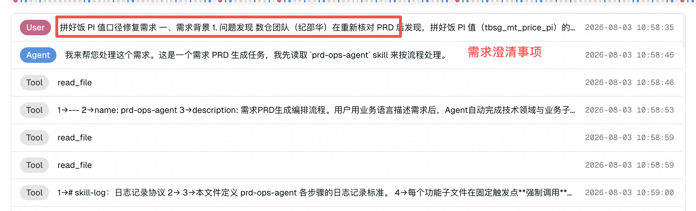 b. 需求澄清中，多轮会话，占据大量上下文 c. 需求澄清结束，转向进行问题排查 & 咨询，未能识别场景，沿着上下文惯性，继续在需求澄清体系下进行，直接导致该 CASE 排查失败。 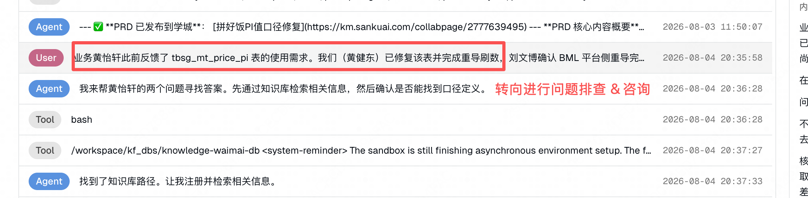 | a. 任务开始，干净上下文 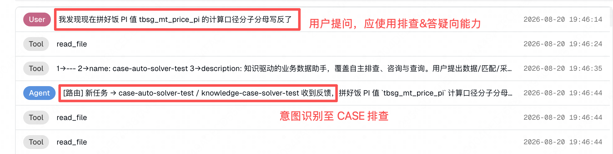 b. ... CASE 排查中，多轮会话，占据大量上下文，tool_calls 100+ c. 排查结束，用户想根据排查结果讨论需求文档 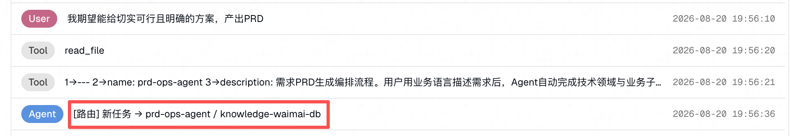 |

方案可参考：[Webhook 订阅指南](https://km.sankuai.com/collabpage/2766020578)

#### 6.4 主子 Agent 流程编排

<!-- HTML 内容 -->


[查看原始 HTML](../../../assets/citadel/2786220186/diagram-04.html)

**场景描述：计算 Agent**

BML 计算团队承担美团 14 条业务线的核心比价计算能力支撑，覆盖境内住宿、到餐、到综、外卖、境外住宿、门票等业务方向。一次需求交付要走完“需求分析 → 技术方案 → 代码开发 → 单元测试 → 集成测试”的完整研发流水线，属于典型的长程任务。团队构建了“1 + 5”的多 Agent 体系，涵盖 1 个调度层 + 5 个执行层专家 Agent。

**上下文问题**

如果让单个 Agent 在同一会话中顺序走完五个环节，上下文稀释必然发生：

1. **全链路上下文超载**：PRD 全文、架构知识库文档、多份编码任务文档、代码 diff、测试日志全部堆积在同一个上下文窗口。早期需求分析阶段读入的 PRD 与承接边界，到编码阶段已被大量代码内容推向上下文中段低权重区，技术方案阶段确定的接口契约、模块边界在编码执行时约束力已经衰减。
2. **串行任务的记忆污染**：多份编码任务文档需严格串行执行，上一任务遗留的代码上下文、文件记忆会污染下一任务的执行（与场景2的“历史结论污染新任务”同源）。
3. **压缩裁减关键结论**：长流程大概率触发多轮上下文压缩，需求边界、方案决策等早期关键结论被摘要化甚至丢失，后续阶段基于不完整信息继续执行。

**解决思路**

与场景1-2“在单一上下文内对抗稀释”的思路不同，这里的解法是通过主子 Agent 的设计来切分上下文：

- **调度层只管编排、不管执行**：task-dispatcher 不亲自执行任务，只负责发现可用 Agent、校验 Skill 完整性、制定执行计划、串行/并行调度子 Agent、跟踪进度和收集交付结果。主 Agent 的上下文中只保留任务级全局状态（计划、进度、交付物路径），不被任何环节的执行细节膨胀。
- **子 Agent 独立上下文冷启动**：每个执行层专家 Agent 以全新上下文启动，只接收上一环节的交付物作为输入。每个环节从干净上下文开始，关键约束通过交付物显式传递，而非依赖会话记忆。
- **交付物落盘作为跨 Agent 上下文载体**：所有交付物持久化存储，以文件形式跨 Agent 传递。文件天然免疫上下文压缩与稀释 —— 子 Agent 需要时随时重新读取。

方案详见：[BML计算代码架构与AI Coding多Agent协同方案](https://km.sankuai.com/collabpage/2759750556)

#### 6.5 固定任务剥离 + 微上下文流水线[^archive-ref-11]

<!-- HTML 内容 -->
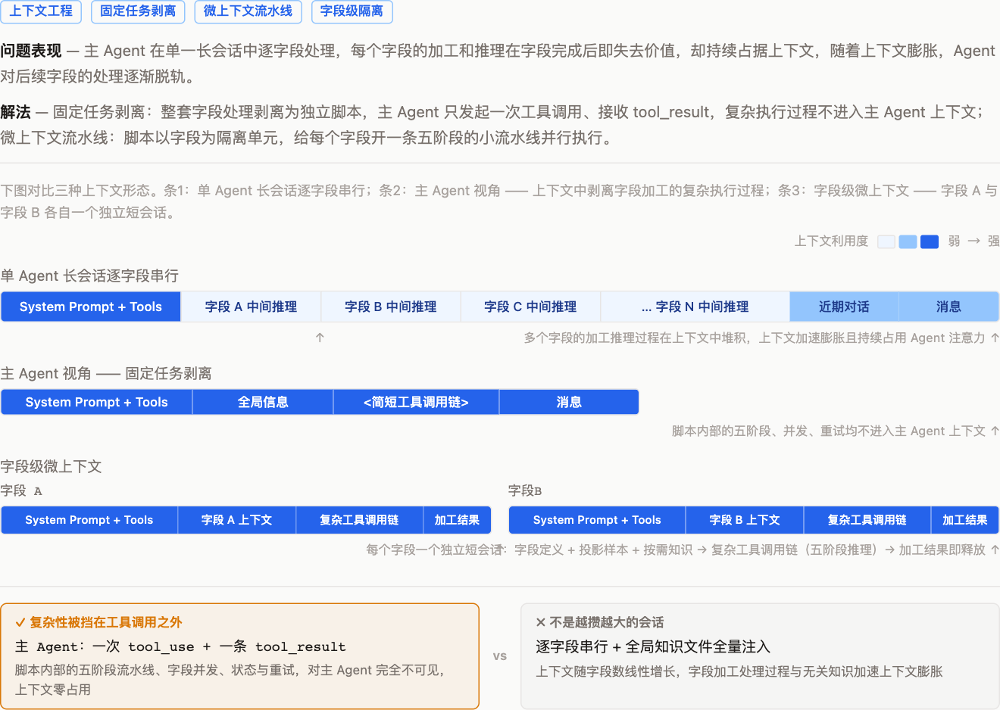

[查看原始 HTML](../../../assets/citadel/2786220186/diagram-05.html)

**场景描述：采集执行Agent**

采集执行 Agent 的单次任务通常需要处理大量交付字段。除直接取值字段外，每个字段都需要经历一整套工作：理解字段加工逻辑 → 识别正常/异常/边界分支 → 从真实报文中选择输入样本 → 为未覆盖分支构造测试输入 → 计算期望输出 → 检查分支覆盖与业务约束。部分字段的输入是嵌套结构复杂的大型 JSON 对象，单个字段的分析上下文就可能很大。如果全部工作由采集执行 Agent 在一个长会话中逐字段完成，这属于典型的批量长程任务。

**问题现象**

若直接让主 Agent 在单一长会话中持有全部字段的处理过程，会触发多条问题路径：

1. **临时信息持续占用 Agent 上下文空间**：字段的分支分析、样本筛选等只在当前字段生成测试用例时有用，字段完成后即失去价值。但主 Agent 长期持有这些中间推理，导致上下文随字段数量线性增长、不同字段的信息相互干扰。
2. **全局知识注入加速上下文膨胀**：金额字段要求结果为正数、时间戳字段需要明确单位和时区、枚举字段需要业务含义 —— 若把所有规范写入一个大知识文件，每次 Agent 都携带大量与当前字段无关的知识加速了上下文膨胀。
3. **批量任务执行的确定性和 Agent 自主执行的不确定性冲突**：在长程任务执行中，状态恢复、输入去重、JSON 结构校验、格式校验等确定性工作如果交给 Agent 自行完成必然会出现分支漏覆盖、expected 与输入错位、中断后重复执行已成功字段等问题，直接影响交付质量。

**解决思路**

在该场景中，对边界清晰、输入输出明确的批量任务，不再让 Agent 阅读 skills + 自主规划，而是把整套字段处理剥离为独立脚本，脚本内部以固定流程调用 LLM API —— 即固定任务剥离 + 微上下文流水线。对主 Agent 而言，这只是一次普通的工具调用：发起调用、接收 tool_result，脚本内部的处理复杂性完全不进入主 Agent 上下文。脚本内部则把批量任务收敛为固定流程，流程中的每次模型调用只携带当前工作单元所需的最小上下文，处理完成即释放、上下文不累积。

- **字段级上下文隔离**：以字段为最小隔离单元，每个字段只能看到完成自身任务所需的信息（字段定义、相关候选记录等），无关 JSON 节点不进入 Prompt。
- **字段内五阶段固定流水线**：分支分析 → 真实样本逐条打标 → 边界构造 → expected 生成 → 独立复核，五个节点按固定依赖顺序串行执行，各有固定输入输出协议，模型节点不承担通用 Agent 的规划职责，会话消息和临时推理在字段处理结束后释放。
- **清晰划分 Agent 与脚本的职责边界**：需要语义理解的工作（分支提取、样本打标、边界构造、expected 推导）交给 Agent；能确定性判断的工作（并发调度、状态保存、输入指纹、断点恢复、结构校验、结果组装）交给程序脚本。
- **知识与工具按需注入**：按字段名精确匹配或加工逻辑正则匹配命中规则后，才向模型节点注入对应的领域知识和工具。

方案详见：[字段级验证数据生成脚本设计说明](https://km.sankuai.com/collabpage/2783824273)

> 📌 **附录区域**

> **📂 折叠块（默认折叠）：1. 工具设计**
>
> [anthropic writing-tools-for-agents](https://www.anthropic.com/engineering/writing-tools-for-agents)
>
> 设计原则：
>
> **选对工具**。更多工具不等于更好结果。常见的错误是把现有 API 端点直接包装成工具，不考虑 Agent 的"可操作性"（affordances）。Agent 的上下文有限，不能像传统软件那样遍历所有数据。与其提供 `list_contacts` 让 Agent 逐个翻阅，不如提供 `search_contacts` 直接定位。工具可以整合多个离散操作：与其提供 `list_users` + `list_events` + `create_event` 三个工具，不如提供一个 `schedule_event` 在内部完成查找空闲时间和创建事件的全流程。设计测试标准是：如果只给人类这些工具，他们是否会以同样的方式拆解任务？
>
> **工具命名空间**。当 Agent 访问数十个 MCP 服务器时，工具名可能冲突。推荐用服务前缀或资源前缀做命名空间，如 `asana_search`、`jira_search`。没有命名空间时 Agent 会困惑"search 指的是哪个服务？"导致调用错误工具。Anthropic 还发现前缀 vs 后缀命名空间在不同模型上性能差异不可忽视，建议在自己的评估框架中测试两种方式。
>
> **提示词工程化工具描述**。工具描述直接加载到 Agent 的上下文窗口中，实质上是"工具行为的系统提示词"。高质量描述应包含：工具做什么和用途、何时使用何时不用、每个参数的描述格式和示例、特殊查询格式、领域特定术语、与其他工具的关系、已知限制。文章用 SWE-Bench 的真实案例证明了工具描述优化的巨大影响：优化 Claude Sonnet 3.5 的编程工具描述后，SWE-bench Verified 分数达到当时最先进水平。此外，MCP 工具还应包含注解标记（如 `destructive: true`、`requires_confirmation: true`）来让 Agent 理解工具的副作用。
>
> 在 Claude 5 代模型的新法则中，Anthropic 进一步提出：从"列出大量工具调用示例"转向"把工具接口设计清楚，让参数本身说明用法"。Claude Code 的 TodoWrite 工具旧描述有 9100 个字符塞满示例，新版本只列出 pending/in_progress/completed 三种状态和一个并发约束（同时只能有一个 in_progress），模型就能正确使用。
>
> 检查清单：
>
> **设计阶段**
>
> 每个工具是否符合 Agent 自然划分任务的方式？
>
> 零散工具是否整合成了高层工具？
>
> 每个工具是否有清晰的单一目的？
>
> **命名阶段**
>
> 工具是否有一致的命名空间？
>
> 看工具名就能判断它属于哪个服务/资源吗？
>
> 参数名是否无歧义？（用 `user_id` 而不是 `user`）
>
> **返回值阶段**
>
> 返回值是否使用语义标识符？
>
> 是否有简洁/详细模式控制详细程度？
>
> 响应是否默认分页/过滤？
>
> **错误处理阶段**
>
> 错误消息是否具体说明了出错原因？
>
> 错误消息是否提供了正确格式示例？
>
> 截断消息是否引导 Agent 采用更好的策略？
>
> **文档阶段**
>
> 描述是否说明了何时使用以及何时不使用？
>
> 特殊查询格式是否有文档说明？
>
> 工具之间的关系是否有解释？
>
> 是否用评估套件测试了描述的效果？

> **📂 折叠块（默认折叠）：2. Prompt 工程**
>
> openAI：[best-practices-for-prompt-engineering-with-the-openai-api](https://help.openai.com/en/articles/6654000-best-practices-for-prompt-engineering-with-the-openai-api)（最近仍在维护）
>
> 核心规范（八条法则）：使用最新模型；将指令放在提示词开头，使用 `###` 或 `"""` 分隔指令和上下文；对背景、结果、长度、格式、风格等尽可能具体和详细；通过示例阐明所需输出格式；从零样本开始，然后少量样本，都不行再微调；减少模糊和不精确的描述；与其只说不该做什么，不如说该做什么；特定于代码生成场景使用"引导词"将模型推向特定模式。同时给出了参数调优规范：Temperature 控制随机性（0=确定性，1=创造性），Top-K 限制候选 token 数量，Top-P 控制累积概率。
>
> <u>openAI:</u>[Prompt engineering best practices for ChatGPT](https://help.openai.com/en/articles/10032626-prompt-engineering-best-practices-for-chatgpt)
>
> 核心规范（六大策略）：写出清晰的指令（把话说详细、让模型充当角色、使用分隔符、指定步骤、指定输出长度）；提供参考文本（减少幻觉）；将复杂任务拆分为更简单的子任务；给模型时间"思考"（CoT）；使用外部工具；系统地测试变更。
>
> 25年：[anthropic-prompt-engineering](https://docs.anthropic.com/en/docs/build-with-claude/prompt-engineering/overview)
>
> 核心规范：使用 XML 标签分区结构化提示词（`<context>`、`<task>`、`<constraints>`、`<format>`），因为 Claude 在训练时大量接触了 XML 格式；找到"正确的海拔高度"——具体到足以有效引导行为，又灵活到足以给模型强启发式；先从最精简的提示测试，再根据失败模式逐步补充；使用少量但多样化的 few-shot 示例（"对 LLM 来说，示例就是价值千言的图片"）；给 Claude 一个角色设定来引导行为模式；使用思维链（CoT）让模型在回答前先推理。
>
> [https://docs.anthropic.com/en/docs/build-with-claude/prompt-engineering/claude-4-prompt-engineering](https://docs.anthropic.com/en/docs/build-with-claude/prompt-engineering/claude-4-prompt-engineering)
>
> 清晰直接（Be clear and direct）。Claude 4 比前代更字面地理解指令——你说什么它就做什么，不会自动泛化。这意味着指令需要明确、直接，避免歧义。Anthropic 在另一篇对比文章中明确指出："Claude Opus 4.7 越来越字面，严格遵循指令，不会自动泛化"——这与 GPT-5.5"越来越高效，直接追求结果，选择最优路径"形成对比。
>
> 展示而非告知（Show don't tell）。使用示例而非描述性规则来引导行为。给 Claude 看你想要的格式和风格，比用文字描述"请写得专业一点"更有效。
>
> 使用 XML 标签结构化。Claude 在训练时大量接触了 XML 格式，用 XML 标签包裹关键部分（指令、示例、输入数据）能帮助 Claude 更好理解上下文。
>
> 给 Claude 角色。通过系统提示赋予 Claude 明确的角色定位，引导其行为模式。
>
> 预填充回复。对于需要精确控制输出格式的场景，可以在 assistant 消息中预填充开头内容来引导 Claude 的输出方向。
>
> Google:：[Prompt Engineering Whitepaper (Kaggle)](https://www.kaggle.com/whitepaper-prompt-engineering)
>
> 核心规范分两大部分。第一部分是 LLM 输出配置：输出长度控制需考虑能源消耗、响应时间和成本；温度（Temperature）控制随机性和创造性；Top-K 和 Top-P 控制采样范围；三种参数需要综合调优而非单独调整。第二部分是提示技巧：通用提示/零样本（直接给指令不提供示例）；单样本和少样本（提供 1 个或多个输入-输出示例，注意打散类别顺序防止记忆）；系统提示（设定整体行为和约束）、角色提示（赋予模型身份）、上下文提示（提供背景信息）三种提示视角；回退提示（Step-back，先让模型思考一般性原理再回答具体问题）；思维链（CoT，让模型分解推理步骤）；自我一致性（多次采样取多数结果）；思维树（ToT，探索多条推理路径）；ReAct（推理与行动交替）；自动提示工程（APE，让模型自动优化提示）。最后给出了系统级最佳实践：指令优于约束（写"确保无错别字"而不是"不要写错别字"）；提供具体示例；保持简洁明了；随模型更新调整提示。

> **📂 折叠块（默认折叠）：3. 关键信息持续注入 —— Anchor 插件使用说明**
>
> 发送该文档给 Agent 即可一键安装 plugin —— [Anchor 插件：对抗长程任务上下文稀释的持续守则注入](https://km.sankuai.com/collabpage/2782328652)
>
> **三个命令上手使用 Anchor 插件**
>
> | 动作 | 命令 | 示例 |
> | --- | --- | --- |
> | 创建<守则> | /anchor:anchor <你的守则> p.s. <守则> 超过 200 字会有过长提示 | 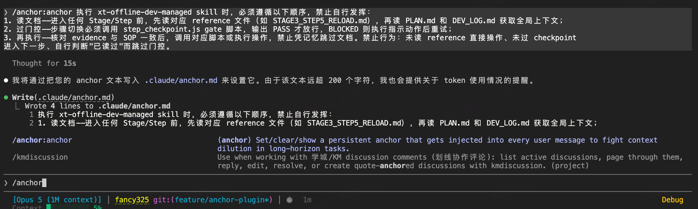 |
> | 查看<守则> | /anchor:anchor show | 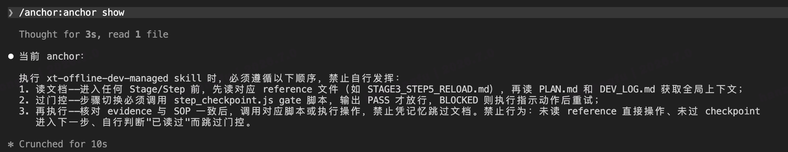 |
> | 删除<守则> | /anchor:anchor off | 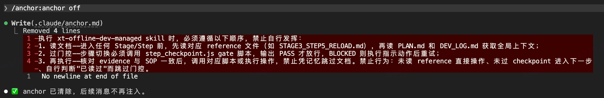 |

> **📂 折叠块（默认折叠）：4. 要解决什么问题**
>
> 在长程会话 & 任务中，Agent 在会话启动时会通过加载系统提示词或读取执行任务的 skills 文件和全局行为规则等（如 AGENTS.md）获取到一系列的规范和约束。这些约束在会话初期能被严格遵守，但随着对话轮次累积，它们的影响力会逐渐衰减。这并非模型“忘记”了这些约束 —— 它们仍然在上下文窗口中。问题在于 Agent 如何理解上下文的内容[^archive-ref-12]：最新的消息占据更高的关注度，**早期的约束在上下文中被逐渐稀释。**更糟的是，当上下文触发压缩时，早期加载的 skills 和规则文件可能在压缩中被裁减或丢失，而非完整保留。上述问题会导致领域 Agent 在跑长程任务时逐渐脱离预设的约束框架，从而出现不符合预期的行为。
>
> 上下文问题不止稀释一个分支 —— 冲突、污染、信息缺失各有其机理。**但稀释在其中占据主干地位**：其一，它不需要任何偶发条件，只要会话足够长必然发生；其二，其余分支多数是上下文稀释引发的次生问题 —— 注意力被稀释，矛盾信息才会悄然通过（冲突）；规则的权重先被稀释，上一任务的执行惯性才压得过路由规则（污染）；上下文膨胀到极限触发压缩，裁减掉的关键信息就是缺失。解决好上下文稀释问题，其余分支随解法一并受益。
>
> Langfuse 就是这层的标准答案：[https://cloud.tencent.com/developer/article/2714837](https://cloud.tencent.com/developer/article/2714837)
>
> - **行车记录仪（Tracing）**：不是可选项，是必选项。没有它，你的 Agent 是在裸奔。
> - **质量评估（Evaluation）**：从「感觉还行」升级到「数据说话」。
> - **Prompt 版本管理**：让最重要的配置可治理、可追溯、可实验。
> - **成本监控**：账单里的钱不会撒谎，但没有工具你看不出来它往哪跑。

---

**注释：**

- Give Codex a map, not a 1,000-page instruction manual：原文是 “Context management is one of the biggest challenges in making agents effective at large and complex tasks. One of the earliest lessons we learned was simple: give Codex a map, not a 1,000-page instruction manual.” [https://openai.com/zh-Hans-CN/index/harness-engineering/](https://openai.com/zh-Hans-CN/index/harness-engineering/)
- SKILL：[Harness 工程之道：Skill 原理与最佳实践](https://mp.weixin.qq.com/s/fVqp5E-UJ9-b7kgAcvekCw)； [https://www.anthropic.com/engineering/equipping-agents-for-the-real-world-with-agent-skills](https://www.anthropic.com/engineering/equipping-agents-for-the-real-world-with-agent-skills)
- 渐进式披露：[https://www.anthropic.com/engineering/equipping-agents-for-the-real-world-with-agent-skills](https://www.anthropic.com/engineering/equipping-agents-for-the-real-world-with-agent-skills)
- 如 llm-wiki 式的 skill rag：[https://km.sankuai.com/collabpage/2767816201](https://km.sankuai.com/collabpage/2767816201)
- 工具输出：设计原则[https://www.anthropic.com/engineering/writing-tools-for-agents](https://www.anthropic.com/engineering/writing-tools-for-agents)
- 工具搜索工具：[https://platform.claude.com/docs/en/agents-and-tools/tool-use/tool-search-tool](https://platform.claude.com/docs/en/agents-and-tools/tool-use/tool-search-tool) [https://www.anthropic.com/engineering/advanced-tool-use](https://www.anthropic.com/engineering/advanced-tool-use)
- 程序化工具调用：[https://platform.claude.com/docs/zh-CN/agents-and-tools/tool-use/programmatic-tool-calling](https://platform.claude.com/docs/zh-CN/agents-and-tools/tool-use/programmatic-tool-calling)
- 加：往每条消息里加关键约束
- 拆：把长流程拆给多个独立上下文
- 减：把固定流程的任务从 Agent 自主执行中减掉
- 换：整个会话换新，依靠交接工件衔接
- 搬：把状态存储搬到上下文之外
- Anthropic：[https://www.anthropic.com/engineering/harness-design-long-running-apps](https://www.anthropic.com/engineering/harness-design-long-running-apps)【随着上下文窗口逐渐填满，模型在执行长时间任务时往往会失去连贯性。一些模型还会表现出“上下文焦虑”，即当它们接近自身认为的上下文极限时，就会过早地结束工作。上下文重置——完全清除上下文窗口并启动一个新的智能体，同时配合结构化的交接机制（该机制会传递前一个智能体的状态和后续步骤）——可以解决这两个问题。这与压缩不同，压缩会将对话的早期部分进行原地概括，以便同一agent能够继续处理缩短后的历史记录。虽然压缩保持了连续性，但它并不能让agent从头开始，这意味着上下文焦虑仍然存在。重置可以提供一个全新的状态，但代价是交接工件会保留足够的状态，以便下一个agent能够顺利地接手工作。在之前的测试中，发现 Claude Sonnet 4.5 的上下文焦虑非常严重，仅靠压缩不足以实现出色的长时间任务性能，因此上下文重置成为框架设计中必不可少的环节。这解决了核心问题，但增加了编排的复杂性、令牌开销和每次框架运行的延迟。Opus 4.5 在很大程度上消除了这种行为。】
- Anthropic 给出的解法：[https://www.anthropic.com/engineering/effective-harnesses-for-long-running-agents](https://www.anthropic.com/engineering/effective-harnesses-for-long-running-agents)
- 上下文焦虑：Anthropic 在一项研究中发现，当模型在接近自身感知的上下文极限时，会表现出「context anxiety」——过早地宣布任务完成、提前结束工作。仅靠压缩不足以支撑长任务性能，因此上下文重置成为 harness 设计的必要环节。 [https://www.anthropic.com/engineering/effective-harnesses-for-long-running-agents](https://www.anthropic.com/engineering/effective-harnesses-for-long-running-agents)
- Langgraph的解法：[https://docs.langchain.com/oss/python/langgraph/thinking-in-langgraph](https://docs.langchain.com/oss/python/langgraph/thinking-in-langgraph)
- 这些规则的权重不断下降：skill 中定义的完整检索协议在长程对话中可能退化为部分执行，甚至被完全跳过。：Anthropic 在工程博客 《Effective context engineering for AI agents》中提出 context rot（上下文腐蚀）这一概念，并强调模型的注意力随上下文变长而摊薄。 [https://www.anthropic.com/engineering/effective-context-engineering-for-ai-agents](https://www.anthropic.com/engineering/effective-context-engineering-for-ai-agents)
- “上一轮刚读过相关文档”的上下文暗示，跳过重新检索流程：《When Not to Trust Language Models》一文中系统对比了模型“凭记忆答”与“检索后答”的边界：对高频、流行的知识，模型倾向于直接用参数化记忆作答且效果不错；但记忆不可靠时模型并不会主动转向检索。换言之，模型对自己“知道什么”缺乏校准——上下文中上一轮刚出现过的文档内容会被当作“已掌握的知识”直接复用，而非触发重新检索。 [https://arxiv.org/abs/2212.10511](https://arxiv.org/abs/2212.10511)
- 上下文惯性：上下文稀释带来了任务惯性：微软的研究《LLMs Get Lost In Multi-Turn Conversation》做了这样一个实验，用 20 万+ 条模拟对话对比“单轮给全信息”与“多轮逐步给信息”两种形态，发现主流开源与闭源模型在多轮形态下性能平均下降 39%，且分解后主要不是能力下降，而是不可靠性（unreliability）显著上升—— 模型过早下结论、对早期轮次的错误假设不修正、后续轮次沿着错误方向越走越远。 这表明，在没有外部干预的前提下，长程多轮会话中，模型的行为越来越被对话已经形成的轨迹决定。 [https://arxiv.org/abs/2505.06120](https://arxiv.org/abs/2505.06120)
- 历史结论污染新任务：《Adaptive Chameleon or Stubborn Sloth》该文在研究“上下文记忆与外部证据冲突时模型怎么办”时发现，当外部证据与模型已有记忆部分吻合时，模型会 cling to 与记忆一致的部分，同时无视冲突部分——即标题中的 “Stubborn Sloth”（固执的树懒）一面。 [https://arxiv.org/abs/2305.13300](https://arxiv.org/abs/2305.13300)
- 主 Agent 把“一堆字段”打包交由脚本执行；脚本中以 LLM API 调用的形式给每个字段开一条五阶段小流水线并行跑，主 Agent 不感知字段加工和推理的过程，只接收返回结果。
- Agent 如何理解上下文的内容：模型倾向于依赖最近几轮对话中的上下文线索来决定行为：《Lost in the Middle》一文中指出，在多文档问答和键值检索任务上系统改变关键信息在上下文中的位置，模型性能呈 U 型曲线。即是，关键信息放在上下文开头（primacy）或结尾（recency）时性能最好，放在中段时性能显著下降。 对照到我们的场景：会话初期注入的 system prompt、skills 文件、AGENTS.md，随着对话累积，逐渐从“开头高权重区”滑向“中段低权重区”——即使从未被截断，其被利用的概率也在下降。 [https://arxiv.org/abs/2307.03172](https://arxiv.org/abs/2307.03172)

[^archive-ref-1]: Give Codex a map, not a 1,000-page instruction manual：原文是 “Context management is one of the biggest challenges in making agents effective at large and complex tasks. One of the earliest lessons we learned was simple: give Codex a map, not a 1,000-page instruction manual.”

    https://openai.com/zh-Hans-CN/index/harness-engineering/

[^archive-ref-2]: 加：往每条消息里加关键约束

[^archive-ref-3]: 拆：把长流程拆给多个独立上下文

[^archive-ref-4]: 减：把固定流程的任务从 Agent 自主执行中减掉

[^archive-ref-5]: 换：整个会话换新，依靠交接工件衔接

[^archive-ref-6]: 搬：把状态存储搬到上下文之外

[^archive-ref-7]: 上下文焦虑：Anthropic 在一项研究中发现，当模型在接近自身感知的上下文极限时，会表现出「context anxiety」——过早地宣布任务完成、提前结束工作。仅靠压缩不足以支撑长任务性能，因此上下文重置成为 harness 设计的必要环节。
    https://www.anthropic.com/engineering/effective-harnesses-for-long-running-agents

[^archive-ref-8]: 这些规则的权重不断下降：skill 中定义的完整检索协议在长程对话中可能退化为部分执行，甚至被完全跳过。：Anthropic 在工程博客 《Effective context engineering for AI agents》中提出 context rot（上下文腐蚀）这一概念，并强调模型的注意力随上下文变长而摊薄。
    https://www.anthropic.com/engineering/effective-context-engineering-for-ai-agents

[^archive-ref-9]: “上一轮刚读过相关文档”的上下文暗示，跳过重新检索流程：《When Not to Trust Language Models》一文中系统对比了模型“凭记忆答”与“检索后答”的边界：对高频、流行的知识，模型倾向于直接用参数化记忆作答且效果不错；但记忆不可靠时模型并不会主动转向检索。换言之，模型对自己“知道什么”缺乏校准——上下文中上一轮刚出现过的文档内容会被当作“已掌握的知识”直接复用，而非触发重新检索。
    https://arxiv.org/abs/2212.10511

[^archive-ref-10]: 历史结论污染新任务：《Adaptive Chameleon or Stubborn Sloth》该文在研究“上下文记忆与外部证据冲突时模型怎么办”时发现，当外部证据与模型已有记忆部分吻合时，模型会 cling to 与记忆一致的部分，同时无视冲突部分——即标题中的 “Stubborn Sloth”（固执的树懒）一面。
    https://arxiv.org/abs/2305.13300

[^archive-ref-11]: 主 Agent 把“一堆字段”打包交由脚本执行；脚本中以 LLM API 调用的形式给每个字段开一条五阶段小流水线并行跑，主 Agent 不感知字段加工和推理的过程，只接收返回结果。

[^archive-ref-12]: Agent 如何理解上下文的内容：模型倾向于依赖最近几轮对话中的上下文线索来决定行为：《Lost in the Middle》一文中指出，在多文档问答和键值检索任务上系统改变关键信息在上下文中的位置，模型性能呈 U 型曲线。即是，关键信息放在上下文开头（primacy）或结尾（recency）时性能最好，放在中段时性能显著下降。
    对照到我们的场景：会话初期注入的 system prompt、skills 文件、AGENTS.md，随着对话累积，逐渐从“开头高权重区”滑向“中段低权重区”——即使从未被截断，其被利用的概率也在下降。
    https://arxiv.org/abs/2307.03172
